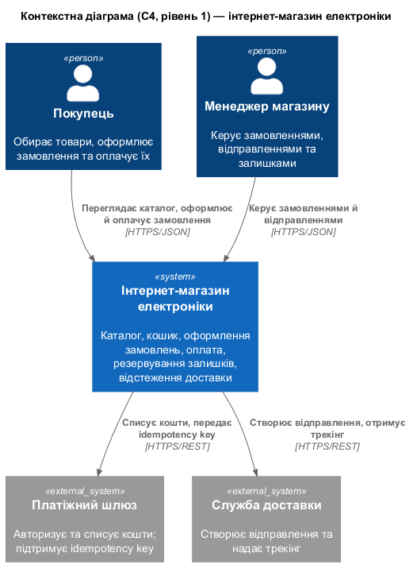
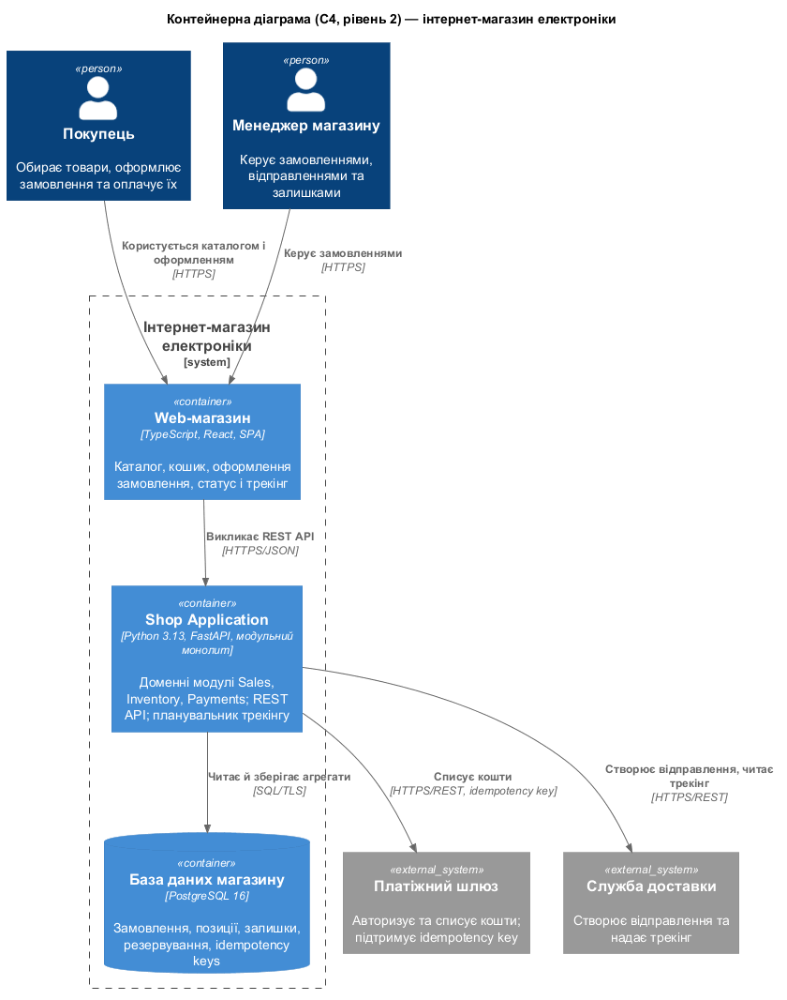
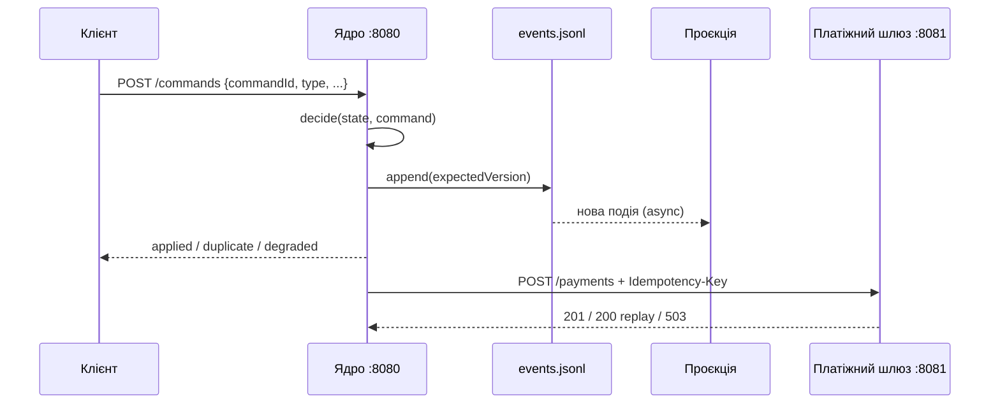
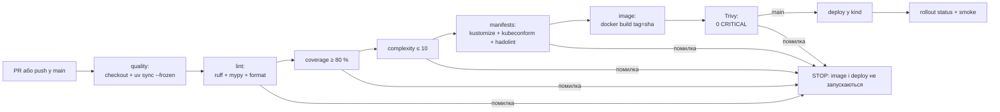

# Ядро домену інтернет-магазину електроніки

**Лабораторна робота № 1.** Архітектурне моделювання та проєктування ядра системи сучасними засобами програмування

**Варіант 2.** Інтернет-магазин із замовленнями

Виконав: студент групи 7.F3.26, Гольда Роман Павлович

Дата: 2026-11-26

> **Використання AI-асистента.** Під час підготовки використано AI-асистента для чернеток коду, тексту й діаграм. Автор перевірив збірку, тести та `mypy --strict` і може пояснити кожне рішення. Оцінки у зважених матрицях — судження автора, а не вимірювання.

## Зміст

1. [Швидкий старт](#1-швидкий-старт)
2. [Крок 1. Вимоги та сценарії якості](#2-крок-1-вимоги-та-сценарії-якості)
3. [Крок 2. Модель домену](#3-крок-2-модель-домену)
4. [Крок 3. Діаграми C4](#4-крок-3-діаграми-c4)
5. [Крок 4. Вибір стеку та стилю](#5-крок-4-вибір-стеку-та-стилю)
6. [Крок 5. Типобезпечна модель домену](#6-крок-5-типобезпечна-модель-домену)
7. [Крок 6. Патерни, DI, порти](#7-крок-6-патерни-di-порти)
8. [Крок 7. Тести та збірка](#8-крок-7-тести-та-збірка)
9. [Артефакти](#9-артефакти)
10. [Обмеження ЛР1](#10-обмеження-лр1)
11. [ЛР2. Паралельне та асинхронне програмування](#11-лр2-паралельне-та-асинхронне-програмування)
12. [ЛР3. Розподілені взаємодії та стійкість](#12-лр3-розподілені-взаємодії-та-стійкість)
13. [ЛР4. Рефакторинг, аналіз якості та тестування спадкового модуля](#13-лр4-рефакторинг-аналіз-якості-та-тестування-спадкового-модуля)
14. [ЛР5. Збірка, контейнери, CI/CD](#14-лр5-збірка-контейнери-cicd)

## 1. Швидкий старт

Потрібен Python 3.12+ (перевірено на 3.13.0) і `uv` 0.13.10. Для ЛР5 також потрібні Docker, kind, kubectl, kustomize, kubeconform, hadolint, trivy і make; на Windows вони працюють у WSL2 Ubuntu 22.04 (див. розділ 14). Самі сервіси працюють на стандартній бібліотеці, runtime-залежностей немає.

```bash
uv sync --frozen --group dev
uv run pytest -q
uv run python -m shop.demo
# ЛР5: ті самі ворота, що в CI
make ci
```

`check.py` — сумісна команда для ЛР1–ЛР4: послідовно запускає `mypy --strict src` і `pytest`. Очікуваний результат:

```text
Success: no issues found in 47 source files
283 passed, 1 xfailed
УСІ ПЕРЕВІРКИ ПРОЙДЕНІ
```

Демонстраційний сценарій:

```bash
# Windows PowerShell
$env:PYTHONPATH="src"; py -3 -m shop.demo
# Linux/macOS
PYTHONPATH=src python3 -m shop.demo
```

Структура репозиторію:

```text
shop-core/
├── README.md, pyproject.toml, uv.lock, Makefile, check.py, openapi.yaml
├── Dockerfile, Dockerfile.single, .dockerignore
├── .github/workflows/ci.yml
├── deploy/
│   ├── kind-config.yaml
│   └── k8s/{base,overlays/{dev,prod}}
├── docs/
│   ├── requirements.md, domain-model.md, decision-matrix.md
│   ├── testing.md, type-safety.md
│   ├── adr/0001-*.md, 0002-*.md, 0003-*.md, 0004-*.md
│   ├── c4/context.puml, container.puml, *.png, lib/
│   ├── diagrams/domain.mmd, domain.png
│   ├── lr3/measurements.json, measurements.md
│   ├── lr5/         # виводи rollout, збою та відкату
│   └── type-safety/*.py
├── src/shop/
│   ├── api/         # ЛР5: HTTP-сервіс, конфігурація, проби
│   ├── domain/      # Result, Money, Order, StockItem, події, фабрики, ціни
│   ├── application/ # OrderService, порти
│   ├── infrastructure/ # пам'ять, годинник, адаптер платежів
│   ├── concurrency/ # ЛР2: стан, конвеєри, збагачення, backpressure
│   ├── distributed/ # ЛР3: два HTTP-сервіси, журнал, проєкція, стійкість
│   └── demo.py
└── tests/           # 283 тести + 1 навмисний xfail
```

## 2. Крок 1. Вимоги та сценарії якості

### Користувацькі історії

- **US-1.** Як покупець, я хочу переглядати каталог і шукати товари за назвою або артикулом, щоб обрати потрібну електроніку.
- **US-2.** Як покупець, я хочу додавати й прибирати товари в кошику та бачити суму зі знижкою й ПДВ, щоб знати остаточну ціну до оформлення.
- **US-3.** Як покупець, я хочу оформити замовлення, обравши доставку й оплату, щоб завершити покупку.
- **US-4.** Як покупець, я хочу оплатити замовлення через зовнішній шлюз і отримати підтвердження, щоб замовлення стало оплаченим.
- **US-5.** Як агент підтримки, я хочу бачити стан замовлення й скасовувати неоплачене замовлення до відправлення, щоб допомогти покупцеві.

Детальні критерії приймання — у [`docs/requirements.md`](docs/requirements.md).

### Обмеження та припущення

| Обмеження | Значення | Джерело |
|---|---|---|
| Пікове навантаження | 500 замовлень/хв ≈ 8,3/с; середнє 50/хв | умова варіанта |
| Затримка оформлення | p95 ≤ 800 мс на стороні системи, без шлюзу | умова варіанта |
| Подвійне списання | неприпустиме; операції ідемпотентні | умова варіанта |
| Продаж без залишку | заборонений; резервування під час оформлення | умова варіанта |
| Відмова шлюзу | не зупиняє каталог і кошик | умова варіанта |
| Валюта / ПДВ | UAH; ПДВ 20% у демонстрації, ставка параметризується | припущення ЛР1 |
| Тарифи доставки | кур'єр 99 UAH, самовивіз 0, експрес 199 | припущення ЛР1 |
| Команда | 1 розробник, 12 тижнів | організаційне припущення |

### Сценарії якості

| Сценарій | Джерело | Стимул | Артефакт | Середовище | Реакція | Міра відповіді |
|---|---|---|---|---|---|---|
| **QS-1 Продуктивність** | Покупець | Оформлює замовлення в пік | `OrderService`: кошик, ціни, резерв, збереження | 500 замовлень/хв, 10× середнього | Замовлення в `Placed`, резерв створено | p95 ≤ 800 мс без шлюзу; помилок ≤ 0,1% |
| **QS-2 Доступність та ізоляція** | Платіжний шлюз | Не відповідає 30 с | Оформлення й каталог/кошик | Пікове навантаження | Замовлення лишається `Placed`; каталог і кошик працюють; повтор ідемпотентний | p95 каталогу ≤ 300 мс; 100% невдалих платежів не переходять у `Paid`; 0 подвійних списань на 100 повторів |
| **QS-3 Узгодженість** | 50 покупців | Купують останню одиницю SKU | Склад і замовлення | Пікове навантаження | 1 замовлення резервує одиницю, решта — `InsufficientStock` | 1 успіх із 50; 0 перепродажів; 0 від'ємних залишків; p95 ≤ 800 мс |

Усі три сценарії **архітектурно значущі**: QS-1 і QS-3 вимагають однієї транзакції без мережевих стрибків, QS-2 — порту й адаптера для шлюзу та стабільного idempotency key. Деталі та трасування — у [`docs/requirements.md`](docs/requirements.md).

## 3. Крок 2. Модель домену

Event storming дав 11 подій, 7 команд, 2 повноцінні агрегати й 3 bounded context.

| № | Подія | Команда | Агрегат | Контекст | У коді ЛР1 |
|---|---|---|---|---|---|
| 1 | `OrderCreated` | `CreateOrder` | Order | Продажі | так |
| 2 | `ItemAddedToCart` | `AddItem` | Order | Продажі | команда так, події немає |
| 3 | `ItemRemovedFromCart` | `RemoveItem` | Order | Продажі | команда так, події немає |
| 4 | `OrderPlaced` | `PlaceOrder` | Order | Продажі | так |
| 5 | `OrderPaid` | `PayOrder` | Order (стан `Paid`) | Продажі + Платежі | так |
| 6 | `PaymentFailed` | `PayOrder` | Payment (межа) | Платежі | так, як `PaymentDeclined`/`PaymentUnavailable` |
| 7 | `OrderShipped` | `ShipOrder` | Order | Продажі | так |
| 8 | `OrderCancelled` | `CancelOrder` | Order | Продажі | так |
| 9 | `StockReserved` | `ReserveStock` | StockItem | Склад | так, як успішний `reserve` |
| 10 | `StockReservationFailed` | `ReserveStock` | StockItem | Склад | так, як `InsufficientStock` |
| 11 | `StockReleased` | `ReleaseStock` | StockItem | Склад | так, як `release` |

| Зв'язок контекстів | Тип | Обґрунтування |
|---|---|---|
| Продажі → Склад | Customer–Supplier | Продажі залежать від резервування; Склад визначає контракт `reserve`/`release` |
| Продажі → Платежі | Customer–Supplier | Продажі замовляють списання; Платежі повертають `PaymentReceipt` або `DomainError` |
| Продажі ↔ Склад | Shared Kernel (`Sku`) | Спільний артикул; зміна формату потребує узгодження |
| Платежі → зовнішній шлюз | Anti-Corruption Layer | Адаптер перекладає мінорні одиниці, статуси й винятки SDK |


Код діаграми: [`docs/diagrams/domain.mmd`](docs/diagrams/domain.mmd). Деталі — [`docs/domain-model.md`](docs/domain-model.md).

### Глосарій

| Термін | Значення |
|---|---|
| Товар (Product) | Картка каталогу: артикул, назва, поточна ціна, наявність |
| Замовлення (Order) | Агрегат `Draft → Placed → Paid → Shipped` або `→ Cancelled` |
| Кошик (Draft) | Стан до оформлення; позиції із зафіксованими цінами |
| Позиція (OrderLine) | Артикул, назва, ціна за одиницю, кількість |
| Резервування | Одиниці товару, закріплені за замовленням |
| Залишок (StockItem) | Скільки одиниць доступно й зарезервовано |
| Ідемпотентність | Повторна оплата з тим самим ключем не списує двічі |

## 4. Крок 3. Діаграми C4

Контекстна діаграма (рівень 1): покупець і менеджер працюють із магазином; магазин викликає платіжний шлюз і службу доставки.



Контейнерна діаграма (рівень 2): SPA, модульний моноліт `Shop Application` на Python 3.13 / FastAPI, PostgreSQL 16 і зовнішні сервіси.



Код: [`context.puml`](docs/c4/context.puml), [`container.puml`](docs/c4/container.puml). Кожен елемент підписаний призначенням, контейнери — технологією, кожен зв'язок — способом взаємодії (`HTTPS/JSON`, `HTTPS/REST`, `SQL/TLS`). Рендер і ліцензія C4-PlantUML — у [`docs/c4/README.md`](docs/c4/README.md).

## 5. Крок 4. Вибір стеку та стилю

### Архітектурний стиль

| Критерій | Вага | Модульний моноліт | Мікросервіси |
|---|---:|---|---|
| QS-1 Продуктивність | 5 | 5 · усе в одному процесі, без мережевих стрибків | 3 · виклик «замовлення → склад» у гарячому шляху |
| QS-2 Доступність та ізоляція | 5 | 3 · падіння модуля впливає на весь застосунок | 5 · збій платежів не зупиняє каталог |
| QS-3 Узгодженість | 5 | 5 · одна ACID-транзакція | 2 · saga, компенсації, eventual consistency |
| Змінюваність | 3 | 3 · новий модуль + спільний деплой | 4 · незалежний деплой сервісу |
| Вартість розробки (1 розробник) | 4 | 5 · одна кодова база, один CI | 2 · кілька сервісів і контрактів |
| Експлуатація | 3 | 5 · один застосунок і одна БД | 2 · розподілені трасування, мережі, інциденти |
| **Сума (макс. 125)** | **25** | **109** | **76** |

### Мова й рантайм

| Критерій | Вага | Python 3.13 | Java 21 |
|---|---:|---|---|
| Виразність моделі | 5 | 5 · `frozen dataclass`, `Union`, `match` | 5 · `record`, `sealed`, `switch` |
| Гарантії компілятора | 4 | 4 · `mypy --strict` + `assert_never` | 5 · `javac` перевіряє вичерпність |
| Продуктивність на 8,3/с | 2 | 3 · GIL не критичний для I/O | 5 · JVM і віртуальні потоки |
| Екосистема | 3 | 5 · багато бібліотек, швидкий старт | 4 · зрілі корпоративні бібліотеки |
| Досвід розробника | 5 | 5 · основна мова, середовище готове | 3 · JDK 21 треба встановлювати |
| Простота збірки | 4 | 5 · `pip`, `pytest`, `mypy` | 3 · Gradle, JDK 21 |
| Пам'ять | 1 | 2 · більший відбиток | 4 · JVM ефективніша |
| **Сума (макс. 120)** | **24** | **109** | **98** |

**Висновок:** модульний моноліт на Python 3.13. Вирішальні фактори — одна транзакція «замовлення + резерв» (QS-3), низьке навантаження, команда з одного розробника й готовий Python. Java має сильніші компіляторні гарантії, але програє за вартістю налаштування; мікросервіси виграють лише за ваг доступності й змінюваності (54 : 50). Повні матриці та перевірка стійкості — у [`docs/decision-matrix.md`](docs/decision-matrix.md), рішення — в [`ADR-001`](docs/adr/0001-python-modular-monolith.md).

## 6. Крок 5. Типобезпечна модель домену

| Вимога | Реалізація | Що гарантує |
|---|---|---|
| Незмінні Value Object-и | `Money`, `Sku`, `OrderId`, `OrderLine`, `Address`, `TrackingNumber` | Поля не змінюються; інваріанти в `__post_init__` |
| Sealed-ієрархії | `Command`, `OrderEvent`, `DomainError`, `Order`, `DeliveryMethod`, `PaymentMethod` | Закрита множина варіантів |
| Стани агрегату | `Draft`, `Placed`, `Paid`, `Shipped`, `Cancelled` | Метод є лише в дозволеному стані |
| Result/Either | `Ok[T]`, `Err[E]`, `map_result`, `flat_map` | Очікувані помилки — значення |
| Pattern matching | `state_name`, `describe_error`, `handle`, `delivery_label` | `assert_never` вимагає вичерпності |
| Generics | `Result[T, E]`, `Transition[S, E]`, `Repository[A, Id]` | Повторне використання без втрати типів |

```python
@dataclass(frozen=True, slots=True)
class Money:
    amount: Decimal
    currency: Currency

    def __post_init__(self) -> None:
        if not self.amount.is_finite():
            raise ValueError("amount має бути скінченним")
        if self.amount < 0:
            raise ValueError("amount не може бути від'ємним")
        object.__setattr__(self, "amount", self.amount.quantize(Decimal("0.01")))

@dataclass(frozen=True, slots=True)
class Placed:
    ...
    def pay(self, receipt: PaymentReceipt, at: datetime) -> Result[Transition[Paid, OrderPaid], DomainError]:
        if receipt.amount != self.total:
            return Err(TotalMismatch(self.total, receipt.amount))
        ...

@dataclass(frozen=True, slots=True)
class Paid:
    ...
    def ship(self, tracking: TrackingNumber, at: datetime) -> Result[Transition[Shipped, OrderShipped], DomainError]:
        ...
```

`Draft` не має `pay`, `Placed` не має `ship`, `Paid` не має `cancel`: недопустимий перехід не компілюється. `mypy --strict` на навмисно неправильних файлах дає:

```text
docs/type-safety/invalid_transition.py:13: error: "Draft" has no attribute "ship"
docs/type-safety/incomplete_match.py:17: error: Argument 1 to "assert_never" has incompatible type "Placed | Paid | Shipped | Cancelled"; expected "Never"
docs/type-safety/wrong_currency.py:11: error: Argument 2 to "Money" has incompatible type "str"; expected "Currency"
```

Ці файли не входять у `src/` і не запускаються. Деталі — у [`docs/type-safety.md`](docs/type-safety.md).

## 7. Крок 6. Патерни, DI, порти

| Патерн | Група | Де | Яку проблему розв'язує | Ціна |
|---|---|---|---|---|
| **Factory Method** | Породжувальний | `domain/factories.py` | Коди доставки/оплати з зовнішнього API не повинні розкидати `if/elif` і конструктори по сервісу; новий спосіб — нова фабрика | Зайві класи й реєстр; для двох способів простіша функція була б коротшою |
| **Decorator** | Структурний | `domain/pricing.py` | Знижки й ПДВ комбінуються незалежно; агрегат не повинен знати ланцюжок | Порядок обгортання неявний; глибокий ланцюг важче налагоджувати; можна випадково застосувати двічі |
| **Adapter** | Структурний | `infrastructure/payment_adapter.py` | Сторонній SDK говорить мінорними одиницями, рядками й винятками; домен не повинен це бачити | Код перетворення й втрата специфічних можливостей провайдера; кожен новий метод шлюзу треба мапити |

Мінімум дві групи виконано: породжувальний + структурні.

```python
service = OrderService(
    orders=InMemoryOrderRepository(),
    inventory=InMemoryInventory({Sku("PHN-0001"): 3}),
    payments=LegacyPayAdapter(SandboxLegacyPayClient(), clock),
    pricing=Vat(PercentageDiscount(BasePrice(Currency.UAH), Decimal("10")), Decimal("0.20")),
    clock=clock,
)
```

| Порт | Призначення | Реалізації |
|---|---|---|
| `OrderRepository` | Збереження агрегату `Order` | `InMemoryOrderRepository`; у ЛР2 — PostgreSQL |
| `InventoryPort` | `reserve`/`release` залишків | `InMemoryInventory`; у ЛР2 — БД |
| `PaymentGateway` | Списання коштів | `LegacyPayAdapter` + `SandboxLegacyPayClient` |
| `Clock` | Поточний час | `SystemClock`; у тестах — `FixedClock` |

| Пакет | Залежить від | Роль |
|---|---|---|
| `domain` | лише стандартна бібліотека | Типи, інваріанти, ціни, фабрики, події |
| `application` | `domain` | `OrderService` і порти |
| `infrastructure` | `application`, `domain` | Адаптери: пам'ять, годинник, шлюз |
| `demo` | усі | Корінь композиції |

Циклів немає; це перевіряють `tests/test_architecture.py`. Деталі патернів — у коді та [`docs/decision-matrix.md`](docs/decision-matrix.md).

## 8. Крок 7. Тести та збірка

```bash
py -3 check.py
```

| Файл | Що перевіряє | Тестів |
|---|---|---:|
| `test_money.py` | Суми, NaN, округлення, валюти, `parse` | 21 |
| `test_ids.py` | Артикули, UUID, адреси, трекінг | 22 |
| `test_pricing.py` | Знижки, ПДВ, порядок декораторів | 18 |
| `test_factories.py` | Коди доставки й оплати | 12 |
| `test_adapter.py` | Успіх, відмова, виняток, idempotency key | 8 |
| `test_inventory.py` | Резерв, звільнення, all-or-nothing | 11 |
| `test_order.py` | Переходи станів і часові інваріанти | 21 |
| `test_order_service.py` | Наскрізні сценарії та повторна оплата | 22 |
| `test_result.py` | `map`, `flat_map`, `unwrap_or` | 6 |
| `test_architecture.py` | Напрямок залежностей | 2 |
| `test_concurrency_*.py` | ЛР2: стан, конвеєри, збагачення, зворотний тиск | 14 |
| `test_lr3_*.py` | ЛР3: Event Sourcing, проєкція, стійкість, контракт, HTTP-ядро | 15 |
| **Разом** | | **172** |

```text
$ py -3 -m mypy --strict src
Success: no issues found in 38 source files

$ py -3 -m pytest -q
171 passed, 1 xfailed
```

Демонстраційний запуск показує повний цикл `Draft → Placed → Paid → Shipped`, відмову платежу з поверненням у `Placed` і звільнення резерву під час скасування. Повний вивід і пояснення — у [`docs/testing.md`](docs/testing.md).

## 9. Артефакти

| Артефакт | Посилання |
|---|---|
| Вимоги, 5 історій, 3 сценарії якості | [`docs/requirements.md`](docs/requirements.md) |
| Event storming, контексти, глосарій | [`docs/domain-model.md`](docs/domain-model.md) |
| Діаграма домену (Mermaid + PNG) | [`docs/diagrams/domain.mmd`](docs/diagrams/domain.mmd) |
| C4 Context і Container (код + PNG) | [`docs/c4/`](docs/c4/) |
| Зважені матриці та стійкість | [`docs/decision-matrix.md`](docs/decision-matrix.md) |
| ADR-001 | [`docs/adr/0001-python-modular-monolith.md`](docs/adr/0001-python-modular-monolith.md) |
| Докази типобезпеки | [`docs/type-safety.md`](docs/type-safety.md) |
| Тести та збірка | [`docs/testing.md`](docs/testing.md) |
| Код домену | [`src/shop/domain/`](src/shop/domain/) |
| Сервіс і порти | [`src/shop/application/`](src/shop/application/) |
| Адаптери | [`src/shop/infrastructure/`](src/shop/infrastructure/) |
| Тести | [`tests/`](tests/) |
| Код ЛР2 | [`src/shop/concurrency/`](src/shop/concurrency/) |
| Вимірювання ЛР2 | [`src/shop/concurrency/bench.py`](src/shop/concurrency/bench.py) |
| Контракт ЛР3 | [`openapi.yaml`](openapi.yaml) |
| Код ЛР3 (два сервіси, журнал, стійкість) | [`src/shop/distributed/`](src/shop/distributed/) |
| Вимірювання ЛР3 | [`docs/lr3/measurements.json`](docs/lr3/measurements.json) |
| Тести ЛР3 | [`tests/test_lr3_*.py`](tests/) |

## 10. Обмеження ЛР1

- Каталог у ЛР1 — read model і фіксація ціни в позиції; окремого сервісу пошуку немає.
- Повернення після відправлення й refund не моделюються: `Paid` не можна скасувати.
- Реальних PostgreSQL, HTTP і черг немає: адаптери в пам'яті; це межа ЛР1 і матеріал ЛР2–ЛР5.
- Конкурентний перепродаж перевіряється на рівні агрегата й сервісу, а не реальними транзакціями БД.
- p95 не вимірюється: сценарій QS-1 визначає архітектуру, вимірювання — у наступних роботах.
- Оцінки в матрицях — судження автора; на захисті кожна пояснюється.

## 11. ЛР2. Паралельне та асинхронне програмування

**Варіант 2.** Інтернет-магазин із замовленнями. Роботу виконано на тому самому ядрі домену з ЛР1, у тому самому репозиторії `shop-core`.

> **Використання AI-асистента.** AI-асистента використано для чернеток коду, тестів і тексту. Числа нижче отримано запуском `py -3 -m shop.concurrency.bench` на цьому ПК; автор перевірив `mypy --strict`, `pytest` і може пояснити кожен вимір.

### 11.1. Інваріант, спільний стан і стенд

Інваріант варіанта: **залишок товару не стає від'ємним, замовлення не продає більше одиниць, ніж є на складі, і резервує товар не більше ніж один раз**. Спільний стан — `dict[Sku, StockItem]` із ЛР1: для кожного артикулу зберігаються `available` і `reserved`. Генератор детермінований: 5 000 замовлень, 50 товарів, 60 % замовлень припадає на «гарячий» `SKU-0000` із залишком 100 одиниць; решта товарів має великий запас. Одна подія — замовлення з однією позицією; цього достатньо для перевірки інваріанта складу.

Стенд: AMD Ryzen 5 3600, **6 фізичних / 12 логічних ядер**, Windows 11 (10.0.26300), Python 3.13.0. Виміри зроблено з повторами; для IO-базової лінії — один повтор, бо кожна подія блокує 5 мс. Числа на іншій машині будуть іншими.

Структура коду:

```text
src/shop/concurrency/
├── model.py        # OrderEvent, детермінований генератор, початковий склад
├── state.py        # Unsafe, Locked, Owner-реалізації спільного стану
├── pipeline.py     # послідовний, потоковий, asyncio- та процесний конвеєри
├── enrichment.py   # три зовнішні виклики, тайм-аут, fallback, partial
├── backpressure.py # необмежена черга, блокування, відкидання
└── bench.py        # усі вимірювання для цього розділу
tests/test_concurrency_*.py
```

Відтворення вимірювань (приблизно 1–2 хвилини):

```bash
# Windows PowerShell
$env:PYTHONPATH="src"; py -3 -m shop.concurrency.bench
# Linux/macOS
PYTHONPATH=src python3 -m shop.concurrency.bench
```

### 11.2. Крок 1. Базова лінія

Послідовний обробник виконує CPU-роботу (1 000 раундів SHA-256 на подію) або IO-затримку 5 мс, після чого резервує товар у `LockedStockStore`.

| Навантаження | Подій | Подій/с (мін–макс) | На подію |
|---|---:|---:|---:|
| CPU-подібне | 20 000 | 1 232 (1 231–1 233) | ≈ 0,81 мс |
| IO-подібне, 5 мс | 2 000 | 188 (188–188) | ≈ 5,3 мс |

Для IO стеля послідовної обробки — `1 / 5 мс = 200` подій/с; вимір 188 подій/с це підтверджує. Для CPU на 6 фізичних ядрах ідеальна межа за законом Амдала — до ×6 (на 12 логічних — до ×12), тому очікувати більшого не можна.

### 11.3. Крок 2. Гонка даних і два виправлення

Небезпечна версія читає `StockItem`, перевіряє залишок і записує назад. Між читанням і записом інший потік може прочитати те саме значення:

```python
item = self._stock.get(event.sku)
if item is not None and item.available >= event.quantity:
    time.sleep(0)  # примусове вікно для стабільного відтворення
    self._stock[event.sku] = replace(
        item,
        available=item.available - event.quantity,
        reserved=item.reserved + event.quantity,
    )
```

`time.sleep(0)` тут — не очікування результату, а модель реального вікна конкурентності: без нього CPython через GIL часто не встигає перемкнути потік. Тест із 8 потоками по 5 000 спроб на гарячий товар (100 одиниць) дав:

| Реалізація | Ідея | Медіана, мс | Прийнято (медіана) | Перевищень ліміту 100 |
|---|---|---:|---:|---:|
| `UnsafeStockStore` | get → перевірка → put | 128,7 | 530 | **10/10** |
| `LockedStockStore` | `threading.Lock` на весь інваріант | 148,4 | 100 | 0/10 |
| `OwnerStockStore` | один потік-власник + `queue.Queue` | 1 247,0 | 100 | 0/10 |

`Unsafe` прийняв 530 замовлень, хоча оновлень залишку вистачило лише на 100: 430 оновлень загублено, тому інваріант «не продати понад залишок» порушено. `Unsafe` продає понад 100 одиниць у кожному з 10 запусків; тест `test_unsafe_store_should_not_oversell` позначено `xfail(strict=True)`, тому він буквально падає щоразу, а в загальному прогоні це очікуваний `xfailed`. `Locked` — найпростіше виправлення й майже не дорожче за небезпечну версію. `Owner` складніший і приблизно у 8–9 разів повільніший на цьому тесті, бо кожне резервування проходить через чергу й `Future`; зате всередині власника немає блокувань, і порядок команд повністю визначений. Для проєкту обрано `Locked` для складу, а `Owner` залишено як ізоляцію для випадків, де важливий порядок за ключем.

### 11.4. Крок 3. Паралельний конвеєр

Конвеєр: виробник кладе події в `queue.Queue(maxsize=100)` (або `asyncio.Queue(maxsize=100)`), обробники беруть їх і резервують товар. Черга обмежена, тому повільний обробник гальмує виробника, а не роздуває пам'ять. Платформні потоки — `threading.Thread`, «віртуальні» в Python — `asyncio`-задачі. Для CPU додано пул процесів, бо GIL не дає потокам паралелити обчислення. У процесному варіанті процеси виконують лише CPU-роботу, а резервування послідовно виконує батьківський процес — це дозволене завданням спрощення `Pool.map`.

| Конфігурація | Подій/с (мін–макс) | Прискорення | Прийнято / відхилено | Макс. черга |
|---|---:|---:|---:|---:|
| **CPU, 5 000 подій** | | | | |
| послідовно | 1 251 (1 244–1 258) | ×1,00 | 2 100 / 2 900 | 0 |
| платформні потоки ×12 | 1 188 (1 160–1 189) | ×0,95 | 2 100 / 2 900 | 100 |
| asyncio-задачі ×12 | 1 245 (1 238–1 247) | ×1,00 | 2 100 / 2 900 | 100 |
| процеси ×12 | 4 756 (4 745–4 773) | **×3,80** | 2 100 / 2 900 | 0 |
| **IO 5 мс, 5 000 подій** | | | | |
| послідовно | 187 (187–187) | ×1,00 | 2 100 / 2 900 | 0 |
| платформні потоки ×64 | 11 676 (11 621–11 680) | **×62** | 2 100 / 2 900 | 100 |
| asyncio-задачі ×2000 | 66 282 (63 811–68 458) | **×354** | 2 100 / 2 900 | 100 |

Прийнято 2 100 = 100 одиниць гарячого товару + 2 000 замовлень інших товарів; 2 900 відмов — це замовлення на вже розпроданий `SKU-0000`.

Інтерпретація:

- **CPU.** Потоки й asyncio не дають прискорення через GIL; це не помилка вимірювання. Процеси дають ×3,8. За законом Амдала для 6 фізичних ядер і частки паралельної роботи `p ≈ 0,9`: `1 / (0,1 + 0,9/6) ≈ 4,0`. Різниця — накладні витрати пулу, послідовне резервування в батьківському процесі та гіперпоточність. Висновок: для CPU у Python потрібні процеси, а не потоки.
- **IO.** Тут обмежує не число ядер, а кількість одночасних очікувань. 64 потоки дають ×62 (близько до 64), а 2 000 asyncio-задач — ×354; останнє обмежене таймером Windows і накладними витратами 2 000 задач. Для IO asyncio/віртуальні задачі кращі.
- **Порядок.** Для варіанта 2 порядок замовлень не є інваріантом; важливі лише відсутність перепродажу й одноразове резервування. Тому розділення за ключем не використовувалося: усі обробники працюють з одним `LockedStockStore`, який атомарно перевіряє залишок.

### 11.5. Крок 4. Асинхронна композиція

Кожна подія збагачується трьома незалежними викликами: платіжний шлюз ≈80 мс, резервування на складі ≈30 мс, доставка ≈40 мс (іноді відмовляє). Усі три стартують одночасно через `asyncio.create_task`, тайм-аут кожного — 100 мс; при `TimeoutError` або `ServiceError` береться резервне значення, а результат позначається `partial = true`.

```python
payment = asyncio.create_task(_guarded(payment.call(event), PAYMENT_FALLBACK, 0.1))
warehouse = asyncio.create_task(_guarded(warehouse.call(event), WAREHOUSE_FALLBACK, 0.1))
delivery = asyncio.create_task(_guarded(delivery.call(event), DELIVERY_FALLBACK, 0.1))
p, w, d = await asyncio.gather(payment, warehouse, delivery)
```

| Сценарій | Послідовно, мс | Паралельно, мс | p95 паралельно, мс | partial |
|---|---:|---:|---:|---|
| усе нормально | 172,4 | 93,7 | 95,0 | ні |
| доставка відповідає за 400 мс | 234,4 | 109,2 | 110,4 | так |
| доставка завжди падає | 172,0 | 94,0 | 95,3 | так |

Послідовний час — сума затримок (80 + 30 + 40 ≈ 150 мс плюс накладні витрати), паралельний — максимум (≈80 мс). Повільний сервіс не тримає подію довше за 100 мс: 109 мс замість 400, ціною `partial = true`. Відмова доставки не скасовує платіж і резервування; результат лишається частковим і явно позначеним.

### 11.6. Крок 5. Зворотний тиск

Виробник генерує 5 000 подій без пауз, споживач витрачає 0,5 мс на подію. Перевірено три політики: необмежена черга, обмежена 100 з блокуванням виробника, обмежена 100 з відкиданням нових подій і лічильником відкинутих. Для Python це заміна Java `Flow`/`SubmissionPublisher`, як дозволяє завдання.

| Політика | Прийнято | Відкинуто | Макс. глибина | p50, мс | p99, мс | Виробник, с |
|---|---:|---:|---:|---:|---:|---:|
| необмежена | 5 000 | 0 | 5 000 | 2 638,2 | 5 222,4 | 0,01 |
| обмежена 100, блокувати | 5 000 | 0 | 100 | 107,2 | 109,0 | 5,15 |
| обмежена 100, відкидати | 101 | 4 899 | 100 | 59,8 | 109,8 | 0,01 |

Необмежена черга нічого не втрачає, але її глибина дорівнює всьому сплеску, а p99 затримки — 5,2 с; при тривалому надлишку пам'ять росте без межі. Блокування тримає затримку ≈109 мс і не втрачає замовлень, але «біль» переходить до виробника: 5,15 с замість 0,01 с. Відкидання швидке, але втрачає 97,9 % замовлень. **Для варіанта 2 обрано обмежену чергу з блокуванням виробника**: замовлення не можна губити, а джерело (кошик/клієнт) може зачекати; відкидання припустиме лише для телеметрії, де свіже значення замінює старе.

### 11.7. Крок 6. Тести, вимірювання та висновок

Команда перевірки:

```bash
py -3 check.py
# mypy --strict: Success: no issues found in 38 source files
# pytest: 171 passed, 1 xfailed
```

| Файл | Що перевіряє | Тестів |
|---|---|---:|
| `test_concurrency_state.py` | Unsafe перепродає (xfail), Locked/Owner зберігають інваріант, повторне резервування не зараховується двічі | 6 |
| `test_concurrency_pipeline.py` | 5 000 подій проходять потоковим і asyncio-конвеєром без втрат; гарячий товар — рівно 100 | 2 |
| `test_concurrency_enrichment.py` | тайм-аут і fallback, відмова сервісу, усі три виклики стартують до першої відповіді | 3 |
| `test_concurrency_backpressure.py` | блокування приймає все, відкидання має межу й лічильник, необмежена черга росте | 3 |
| **Разом** | | **14** |

Тести не використовують `Thread.sleep` для очікування: застосовано `threading.Barrier`, `Thread.join`, `asyncio.wait_for`, `asyncio.Event`; `time.sleep(0)` є лише вікном у небезпечній реалізації, а `time.sleep(0,5 мс)` — імітацією роботи споживача. Тест `test_unsafe_store_should_not_oversell` позначений `xfail(strict=True)` і падає на `Unsafe` у 10/10 запусків; якщо дефект випадково зникне, strict-xfail стане `XPASS` і провалить збірку.

**Висновок.** Для інтернет-магазину обрано обмежену чергу з блокуванням виробника і `LockedStockStore`: це зберігає головний інваріант — жодного продажу понад залишок і жодного замовлення, зарезервованого двічі. Для IO-навантаження asyncio-задачі дають ×354 проти послідовного обробника, для CPU у Python потрібні процеси (×3,8 на 6 фізичних ядрах); потоки й asyncio через GIL не прискорюють обчислення. Асинхронне збагачення скорочує затримку з ≈172 до ≈94 мс і обмежує повільний сервіс тайм-аутом 100 мс.

**Обмеження вимірювань:** 6 фізичних / 12 логічних ядер, Windows-таймер для IO, змодельовані зовнішні сервіси, одна позиція на замовлення, для IO-базової лінії один повтор; JMH-подібної точності немає, числа слід читати як порядок величини. Проти цього тесту гонка відтворювалася 10/10, але сам тест імовірнісний; проходження тестів не доводить відсутності всіх гонок.

## 12. ЛР3. Розподілені взаємодії та стійкість

**Варіант 2.** Інтернет-магазин із замовленнями. Роботу виконано на тому самому ядрі домену з ЛР1–ЛР2, у тому самому репозиторії `shop-core`. Два сервіси — окремі процеси: **«Ядро»** ([`src/shop/distributed/core_service.py`](src/shop/distributed/core_service.py), порт 8080) і **«Платіжний шлюз»** ([`payment_service.py`](src/shop/distributed/payment_service.py), порт 8081). Контракт — [`openapi.yaml`](openapi.yaml), сирі вимірювання — [`docs/lr3/measurements.json`](docs/lr3/measurements.json).

> **Використання AI-асистента.** AI-асистента використано для чернеток коду, тестів і тексту. Числа нижче отримано запуском `py -3 -m shop.distributed.bench` на цьому ПК 2026-11-26; автор перевірив `mypy --strict`, `pytest` і може пояснити кожен параметр та вимір.

### 12.1. Агрегат, події та проєкція

Агрегат — `Order` (варіант 2). Журнал містить три типи подій:

| Подія | Коли виникає | Що фіксує |
|---|---|---|
| `OrderPlaced` | `PlaceOrder` | замовлення, покупця, позиції, суму |
| `PaymentCaptured` | `PayOrder` після успішного платежу | суму, `transactionId`, час |
| `OrderCancelled` | `CancelOrder` до оплати | причину й час |

`decide(state, command)` — чиста функція: перевіряє інваріанти й повертає нові події або `DomainError`. `evolve(state, event)` застосовує подію; стан — це `fold(evolve, initial, events)`. Команди `PlaceOrder`, `PayOrder`, `CancelOrder` мають обов'язковий `commandId`.

Журнал — `events.jsonl`, один рядок = одна подія: `globalPosition`, `streamId`, `version`, `commandId`, `eventType`, `payload`, `recordedAt`. Додавання вимагає `expectedVersion`; якщо версія змінилася, повертається `VersionConflict` і HTTP 409. `commandId` індексується: повтор команди повертає ті самі події й не додає нових. Стан читається з журналу; проєкція `OrderView` (статус, сума, кількість позицій, версія) оновлюється окремим потоком із checkpoint. `POST /projection/replay` переграє журнал із початку; контрольна сума до і після збігається.

### 12.2. Схема взаємодії



Контракт шлюзу: `POST /payments` із заголовком `Idempotency-Key` (схема `order:<uuid>:payment`), тіло `{orderId, amount, currency}`, відповіді 201/200/400/409/503. Клієнт — «толерантний читач»: невідомі поля ігнорує. Нові необов'язкові поля сумісні; перейменування поля, нове обов'язкове поле або зміна типу — ламаючі й вимагають нової версії. Тест контракту [`test_lr3_contract.py`](tests/test_lr3_contract.py) звіряє реальні відповіді зі схемою `openapi.yaml`.

### 12.3. Патерни стійкості

Композиція: **Bulkhead → Retry → (Circuit Breaker → Timeout → HTTP)**. Bulkhead стоїть зовні, тому повільна залежність не займає всі потоки; Retry робить паузи; кожна спроба проходить через вимикач і тайм-аут; коли коло розімкнене, повторювач одразу зупиняється й не добиває сервіс.

| Параметр | Значення | Обґрунтування |
|---|---|---|
| Timeout | 0,25 с на спробу | нормальна відповідь ≈80 мс, запас ×3; повільна (≈1 с) відсікається |
| Retry | 4 спроби, база 0,1 с, ×2, максимум 0,8 с | при 50 % помилок 4 спроби дають \(1-0{,}5^4=93{,}75\%\) успіху |
| Jitter | половина паузи фіксована, половина випадкова | паузи 50–100, 100–200, 200–400 мс; розсіює шторм повторів |
| Circuit Breaker | 8 послідовних збоїв, пауза 2 с, 1 пробний виклик | 4 спроби на команду; 8 — це дві повністю невдалі команди. Поріг 3 у пілоті розмикав коло на випадкових 50 % помилок (3/200 успіху), тому піднято до 8 |
| Bulkhead | 8 одночасних викликів | відповідає 8 воркерам вимірювання; при переповненні — одразу `degraded`, без черги |
| Fallback | HTTP 200, `status=degraded`, `fallback=payment_deferred` | замовлення лишається `placed`, ядро приймає наступні команди; деградація явно позначена |

Retry дозволений лише з ключем ідемпотентності: `PaymentRequest` не можна створити з порожнім ключем, а ключ замовлення — `order:<uuid>:payment`. Fallback не маскує збій: відповідь містить `degraded: true`, код і повідомлення помилки. Найгірший час захищеної команди — \(4 \times 0{,}25 + 0{,}05 + 0{,}1 + 0{,}2 \approx 1{,}35\) с, що менше за 10-секундний тайм-аут клієнта вимірювання; інакше зовнішній клієнт обірвав би команду раніше, ніж Retry вичерпає спроби.

### 12.4. Гіпотези

| Режим | Гіпотеза до вимірювання |
|---|---|
| нормально | обидва клієнти — 100 % успіху, p95 ≤ 150 мс, по 200 викликів |
| повільно | наївний — 100 % успіху, але p95 ≈ 1 с; захищений швидко деградує, викликів до шлюзу небагато |
| частка помилок | наївний — ≈50 % успіху; захищений — ≥90 % завдяки 4 спробам, p95 вища, викликів більше за 200 |
| недоступний | обидва — 0 % успіху; захищений робить значно менше викликів після розмикання кола, p95 не гірша |

### 12.5. Вимірювання

Стенд: Windows 11 (10.0.26300), 12 логічних ядер, Python 3.13.0; **200 команд на режим на клієнта**, 8 паралельних виконавців; кожна команда — `PayOrder` для заздалегідь створеного замовлення. `Calls` — запити, що дійшли до платіжного шлюзу (лічильник шлюзу); `attempts` — спроби клієнта, вони збігаються.

| Режим | Клієнт | Успіх, % | Деградовано, % | p50, мс | p95, мс | p99, мс | макс, мс | Викликів | CB |
|---|---|---:|---:|---:|---:|---:|---:|---:|---|
| нормально | наївний | 100,0 | 0,0 | 106,8 | 124,5 | 161,8 | 163,2 | 200 | — |
| нормально | захищений | 100,0 | 0,0 | 107,7 | 125,7 | 188,0 | 190,5 | 200 | closed |
| повільно | наївний | 100,0 | 0,0 | 1020,2 | 1042,6 | 1043,9 | 1046,4 | 200 | — |
| повільно | захищений | 0,0 | 100,0 | 2,9 | 29,7 | 387,3 | 527,1 | 8 | open |
| 50 % помилок | наївний | 48,5 | 51,5 | 42,3 | 112,5 | 124,1 | 125,9 | 200 | — |
| 50 % помилок | захищений | 93,0 | 7,0 | 119,7 | 642,5 | 748,9 | 762,6 | 362 | closed |
| недоступний | наївний | 0,0 | 100,0 | 4,7 | 28,2 | 40,8 | 539,8 | 200 | — |
| недоступний | захищений | 0,0 | 100,0 | 2,8 | 29,2 | 101,3 | 510,3 | 8 | open |

Інтерпретація:

- **Нормально.** Обидва клієнти — 100 %, p95 124,5 проти 125,7 мс: накладні витрати захисту в межах шуму. Викликів рівно 200, повторів немає.
- **Повільно.** Наївний чекає ≈1,02 с і отримує 100 %. Захищений відсікає кожну спробу за 0,25 с; перші 8 викликів отримали тайм-аут, після 8 збоїв коло розімкнене, решта команд деградовані майже миттєво (p50 2,9 мс). p95 29,7 мс приховує хвіст: p99 387,3 мс, максимум 527,1 мс — це команди, які встигли зробити кілька спроб. Ядро весь час відповідало.
- **50 % помилок.** Наївний: 48,5 % — близько до очікуваних 50 %. Захищений: 93,0 % (теоретично 93,75 % за 4 спроби) ціною 362 викликів замість 200 (×1,81) і p95 642,5 мс. Вимикач не розмикався: 8 послідовних збоїв на тлі успіхів — рідкісна подія, тому поріг 8 не спрацьовує на випадкових коливаннях.
- **Недоступний.** Обидва — 0 %, але наївний зробив 200 марних викликів, а захищений — 8, після чого коло розімкнене. p95 у обох ≈29 мс; максимальні 510–540 мс — це перші спроби з тайм-аутом/очікуванням з'єднання.

### 12.6. Circuit Breaker: повний цикл

Окремий сценарій на реальному сервісі (режим `unavailable`, потім `normal`):

1. після 8 невдалих спроб — `closed → open`;
2. після паузи 2,2 с пробний виклик усе ще невдалий — `open → half_open → open`;
3. після ще 2,2 с і повернення нормального режиму пробний виклик успішний — `open → half_open → closed`.

Повна послідовність у журналі переходів `/stats`: `closed → open → half_open → open → half_open → closed`. Це саме та поведінка, яку перевіряє `test_circuit_breaker_state_transitions`.

### 12.7. Відставання проєкції

Під навантаженням проєкція відставала не більше ніж на **2 події**; максимальний виміряний lag — **29,6 мс**, після завершення команди вона наздоганяла журнал за **0,8–24,6 мс**. Найбільший lag у наївного клієнта в режимі `slow` (29,6 мс) — це вік останньої застосованої події, а не затримка проєктора: сама подія з'являється в журналі після 1 с платежу. Тобто модель читання кінцево узгоджена; одразу після команди `GET /projection/orders` може показати попередній статус, а `GET /orders/{id}` читає журнал і дає актуальний. Для інваріантів, що вимагають миттєвої узгодженості (наприклад, «не продати останню одиницю»), перевірка лишається на стороні запису, в агрегаті.

### 12.8. Тести

| Файл | Що перевіряє | Тестів |
|---|---|---:|
| `test_lr3_event_sourcing.py` | replay відновлює проєкцію; конфлікт версій; дубль команди; журнал переживає перезапуск; lag і checkpoint | 5 |
| `test_lr3_resilience.py` | переходи Circuit Breaker; кількість повторів і паузи; вичерпання Retry; вимикач зупиняє повтори; Timeout; обов'язковий ключ ідемпотентності; Bulkhead | 7 |
| `test_lr3_contract.py` | відповіді 201/200/400/409/503 збігаються зі схемою `openapi.yaml` | 1 |
| `test_lr3_core.py` | дубль команди через HTTP; деградована відповідь; replay; наскрізний платіж та ідемпотентність | 2 |
| **Разом** | | **15** |

Тести станів не використовують реальних `sleep`: годинник, паузи й jitter передаються як залежності (`FakeClock`, `RecordingSleeper`, `FixedJitter`), а Bulkhead перевіряється `threading.Event`. Мережеві тести піднімають справжній HTTP-сервер на вільному порту з нульовою затримкою. Повний прогін:

```text
$ py -3 check.py
mypy --strict: Success: no issues found in 38 source files
pytest: 171 passed, 1 xfailed
```

### 12.9. Як запустити

```powershell
$env:PYTHONPATH="src"

# 1) платіжний шлюз
py -3 -m shop.distributed.payment_service --port 8081

# 2) ядро в іншому вікні (захищений клієнт)
py -3 -m shop.distributed.core_service --port 8080 --client protected `
  --payment-url http://127.0.0.1:8081

# 3) вимірювання: сам піднімає шлюз, наївне й захищене ядро
py -3 -m shop.distributed.bench --commands 200 --workers 8

# 4) типи й тести
py -3 check.py
```

`bench` сам створює тимчасові журнали в `var/lr3/bench/<час>/`, пише логи процесів і зберігає результати в `docs/lr3/measurements.json` та `docs/lr3/measurements.md`. Для ручного перемикання режимів: `POST /_admin/mode` з тілом `{"mode":"normal"}` (або `slow`, `errors`, `unavailable`); стан — `GET /_admin/state`.

### 12.10. Висновок і обмеження

Захист дав очікуваний ефект: у режимі 50 % помилок Retry з ключем ідемпотентності підняв частку успішних команд з **48,5 % до 93,0 %** ціною **×1,81** викликів і p95 **642,5 мс**; у режимах `slow` і `unavailable` Circuit Breaker скоротив число викликів до **8** і втримав p95 **≈29 мс**, хоча самі команди в `slow` деградували (0 % успіху). Bulkhead у цьому вимірюванні не спрацьовував (8 воркерів = ліміт 8), його межу доводить окремий тест.

Чого захист **не** вирішує: запис події та зовнішній платіж не атомарні. У `slow` перші 8 платежів могли фактично пройти після тайм-ауту клієнта, коли ядро вже повернуло `degraded`; повтор тієї самої команди з тим самим ключем отримав би replay і записав би подію, але для повної гарантії потрібен Transactional Outbox або Saga. Також ядро одне, журнал — файл JSONL, а вимикач і Bulkhead живуть у пам'яті процесу; горизонтальне масштабування й спільна БД не перевірялися.

Що я змінив би далі: виніс би публікацію події й виклик шлюзу в Outbox, зберіг би `commandId`-відповіді для деградованих команд, виніс би ліміти Bulkhead у конфігурацію на залежність і додав би моніторинг p99 та частки деградацій. Поріг 8 і тайм-аут 0,25 с вважаю робочими для цього стенда, але на іншому навантаженні їх треба переміряти.

## 13. ЛР4. Рефакторинг, аналіз якості та тестування спадкового модуля

**Варіант 2.** Інтернет-магазин із замовленнями. Спадковий модуль — `src/shop/legacy/order_pricing.py`: розрахунок ціни замовлення (знижка за кількістю, купон, знижка лояльності, податок, доставка). Оригінал — 111 фізичних рядків (88 SLOC), без тестів і специфікації, з навмисними вадами: одна довга функція, вкладені умови, магічні числа й повторений код.

Нова вимога: **знижки не складаються — застосовується лише найбільша; промокод без впливу не зберігається у звіті.**

> **Використання AI-асистента.** AI-асистента використано для чернеток коду, тестів і тексту. Усі числа отримано запуском на цьому ПК; автор перевірив `check.py` і може пояснити кожне рішення.

### 13.1. Базова лінія і метрики «до / після»

Характеризаційні тести — `tests/test_legacy_pricing.py`: 52 набори (48 на момент baseline + 4 додані під час мутаційного аналізу), входи — `tests/lr4/pricing_cases.json`, зафіксовані відповіді — `tests/lr4/pricing_expected.json`. Покриття — 100 % рядків і 100 % гілок.

Під час перегляду відповідей виявлено нелогічну спадкову поведінку: від'ємна ціна дає від'ємний підсумок; нульова ціна з кур'єром усе одно коштує 99 грн; промокод зберігався навіть за нульової знижки. Перші дві вади зафіксовано тестами й **не виправляно** (це змінило б поведінку); третю виправлено новою вимогою через TDD.

| Метрика | До (`930c256` + `f02dd29`) | Після (`af76401`) | Інструмент |
|---|---:|---:|---|
| Максимальна цикломатична складність | 23 | 4 | radon 6.0.1, `radon cc -j` |
| Середня цикломатична складність | 12.0 | 1.52 | radon 6.0.1, `radon cc -j` |
| Найдовша функція | 91 рядок (`calculate_order_price`) | 30 рядків (`calculate_price`) | AST у `scripts/lr4_metrics.py` |
| Покриття рядків | 100 % | 100 % | coverage.py 7.17.5, `--branch` |
| Покриття гілок | 100 % | 100 % | coverage.py 7.17.5, `--branch` |
| Зауваження лінтера | 8 | 0 | ruff 0.17.6, `C901,PLR0912,PLR0915,PLR2004,PLR0913` |
| LOC / SLOC файлу (контекст) | 111 / 88 | 313 / 239 | radon 6.0.1, `radon raw -j` |

Виміри знято одним скриптом з тими самими налаштуваннями: `py -3 scripts/lr4_metrics.py --label before` і `--label after`. Сирі результати — `docs/lr4/metrics_before.json` і `docs/lr4/metrics_after.json`. Файл став довшим (111 → 313 LOC), бо магічні числа замінено іменованими правилами, а рядкові типи — enum-ами й dataclass-ами; натомість кожна функція стала короткою й простою.

### 13.2. Знайдені code smells і рефакторинги

Рядки вказано для оригінального модуля в коміті `930c256`; після рефакторингу нумерація інша. Усього — 6 smells і 5 окремих рефакторинг-комітів; деякі коміти усувають кілька запахів одразу.

| Smell | Де (рядки) | Що не так | Рефакторинг | Коміт |
|---|---|---|---|---|
| Long Method / God Function | 21–111 | одна функція на 91 рядок рахує підсумок, три знижки, податок, доставку й звіт; CC 23 | Extract Method: `_money`, `_subtotal`, `_quantity_discount`, `_coupon_discount`, `_loyalty_discount`, `_delivery_cost`, `_tax`, `_final_total`, `_build_report` | `037bd89`, `f2187cb`, `f5d9bf2`, `9e20dc3`, `752e6e5` |
| Nested if/switch | 38–46, 49–58, 61–74, 83–96 | ланцюжки if/elif по кількості, коду купона, статусу клієнта й способу доставки; нова варіанта вимагає правити функцію | Replace Conditional with Table: `QuantityRule`, `CouponRule`, `LOYALTY_RATES`, `LOYALTY_YEARS_RULES`, `DeliveryRule`; `StrEnum` | `f2187cb`, `f5d9bf2`, `9e20dc3` |
| Magic Numbers | 38, 40, 42, 51, 54, 57, 63, 65, 67, 71, 73, 81, 86, 89, 91, 94 | 50/20/10, 0.15/0.10/0.05, 500/1000/800, 0.03/0.05/0.07, 5/10, 0.20, 99/199, 1000/2000 без назв | іменовані правила й константи: `QuantityRule`, `CouponRule`, `LOYALTY_RATES`, `LOYALTY_YEARS_RULES`, `DeliveryRule`, `TAX_RATE`, `MONEY_STEP` | `f2187cb`, `f5d9bf2`, `9e20dc3` |
| Duplicated Code | 36, 46, 59, 76, 79, 81, 98; 39/41/43/52/55/63/65/67/72/74; 85–94 | повторений `quantize`, повторене `subtotal * rate`, повторена структура безкоштовної доставки | Extract Method `_money`, `_delivery_cost`, `_tax`, `_final_total`, `_discounted` | `037bd89`, `9e20dc3`, `752e6e5` |
| Primitive Obsession | 23–26, 100–110 | `customer_type: str`, `delivery: str`, `promo_code: str`, звіт — `dict[str, object]` | `CustomerStatus`, `DeliveryMethod`, `CouponCode` (`StrEnum`), `PricingRequest`, `PricingBreakdown`, `DiscountSelection` | `f5d9bf2`, `9e20dc3`, `752e6e5` |
| Long Parameter List | 21–27 | п'ять позиційних параметрів, легко переплутати | Parameter Object `PricingRequest`; публічний `calculate_order_price` залишено адаптером сумісності, робоча функція — `calculate_price(request)` | `752e6e5` |

П'ять рефакторинг-комітів: `037bd89` (Extract Method для `_money`/`_subtotal`), `f2187cb` (таблиця знижки за кількістю), `f5d9bf2` (таблиця купонів), `9e20dc3` (таблиці лояльності й доставки, enum-и, податок/підсумок/звіт), `752e6e5` (Parameter Object). Після кожного коміту запускалися характеризаційні тести; під час рефакторингу **жодне очікуване значення не змінилося**.

### 13.3. TDD для нової вимоги

Тести — `tests/test_legacy_pricing_tdd.py`; логи червоних кроків — `docs/lr4/tdd/`. Кожен цикл: red (тест падає) → green (мінімальна реалізація) → refactor (під зеленими тестами).

| Цикл | Тест | Червоний крок | Red | Green | Refactor |
|---|---|---|---|---|---|
| 1 | `test_only_largest_discount_is_applied` | `assert Decimal('50.00') == Decimal('0.00')` | `f459c26` | `05021db` | `f3b50ea` |
| 2 | `test_zero_effect_promo_is_not_stored` | `assert 'NO-SUCH-CODE' is None` | `71e967a` | `13dd6a2` | `82f1bd3` |
| 3 | `test_losing_promo_is_not_stored` | `assert 'SAVE10' is None` | `33f4aa2` | `d6731f6` | `587e24e` |

```python
def test_only_largest_discount_is_applied() -> None:
    result = calculate_order_price(
        [LegacyItem("A", Decimal("100.00"), 10)], "gold", 0, "SAVE20", "pickup"
    )
    assert result["quantity_discount"] == Decimal("0.00")
    assert result["coupon_discount"] == Decimal("200.00")
    assert result["loyalty_discount"] == Decimal("0.00")
    assert result["total"] == Decimal("960.00")
    assert result["promo_code"] == "SAVE20"


def test_zero_effect_promo_is_not_stored() -> None:
    result = calculate_order_price(
        [LegacyItem("A", Decimal("100.00"), 1)], "regular", 0, "NO-SUCH-CODE", "pickup"
    )
    assert result["promo_code"] is None
    assert result["total"] == Decimal("120.00")


def test_losing_promo_is_not_stored() -> None:
    result = calculate_order_price(
        [LegacyItem("A", Decimal("100.00"), 50)], "regular", 0, "SAVE10", "pickup"
    )
    assert result["quantity_discount"] == Decimal("750.00")
    assert result["coupon_discount"] == Decimal("0.00")
    assert result["promo_code"] is None
    assert result["total"] == Decimal("5100.00")
```

Точні виводи червоних кроків:

```text
# docs/lr4/tdd/cycle1-red.txt
> assert result["quantity_discount"] == Decimal("0.00")
E AssertionError: assert Decimal('50.00') == Decimal('0.00')

# docs/lr4/tdd/cycle2-red.txt
> assert result["promo_code"] is None
E AssertionError: assert 'NO-SUCH-CODE' is None

# docs/lr4/tdd/cycle3-red.txt
> assert result["promo_code"] is None
E AssertionError: assert 'SAVE10' is None
```

Під час рефакторингу (до TDD) очікування 48 характеризаційних тестів не змінювалися. У TDD-комітах змінено лише ті очікування, які описують нову вимогу: 6 наборів у циклі 1 (знижки складалися), 6 полів `promo_code` у циклі 2 і 1 поле `promo_code` у циклі 3. Це навмисна зміна поведінки, а не рефакторинг.

### 13.4. BDD-сценарії

Файл сценаріїв — `tests/features/order_pricing.feature` (`# language: uk`), кроки — `tests/test_legacy_pricing_bdd.py` (pytest-bdd 9.0.1). Запуск:

```bash
py -3 -m pytest tests/test_legacy_pricing_bdd.py -q
# 5 passed
```

Сценарії:

1. **Застосовується лише найбільша знижка** — нова вимога.
2. **Промокод без знижки не потрапляє у звіт** — крайовий випадок нової вимоги.
3. **Промокод, що програв більшій знижці, не потрапляє у звіт** — крайовий випадок нової вимоги.
4. **Податок нараховується після знижки** — старе правило.
5. **Кур'єрська доставка безкоштовна від 1000 грн після знижки** — старе правило.

Приклад форми:

```gherkin
# language: uk
Сценарій: Застосовується лише найбільша знижка
  Дано кошик:
    | товар   | ціна   | кількість |
    | Телефон | 100.00 | 10        |
  І клієнт має статус "gold"
  І введено промокод "SAVE20"
  І обрано доставку "pickup"
  Коли я розраховую ціну замовлення
  Тоді знижка за кількістю становить 0.00 грн
  І знижка за промокодом становить 200.00 грн
  І підсумок становить 960.00 грн
```

Текст сценаріїв не містить назв класів і методів — лише терміни предметної області: кошик, клієнт, промокод, доставка, знижка, податок, підсумок.

### 13.5. Мутаційне тестування

Інструмент — mutmut 3.8.1, запуск у WSL Ubuntu 22.04 з Python 3.13.18 (нативний Windows mutmut не підтримує). Ціль — лише `src/shop/legacy/order_pricing.py`; тести — `tests/test_legacy_pricing.py` і `tests/test_legacy_pricing_tdd.py`. Код і тести ті самі, що на Windows.

Перший прогін: **167 мутантів, 162 вбито, 5 вижили** (97,0 %). Виживших розібрано:

| Мутант | Мутація | Чому вижив / що зроблено | Статус |
|---|---|---|---|
| `_money__mutmut_2` | `rounding=ROUNDING` → `rounding=None` | не було нагоди перевірити HALF_UP на третій цифрі; додано `rounding_half_up_subtotal` (10.005 → 10.01) | вбито |
| `_money__mutmut_4` | прибрано `rounding=...` | те саме; вбито тим самим тестом | вбито |
| `_subtotal__mutmut_6` | `continue` → `break` | нульова кількість була останньою; додано `zero_quantity_first` | вбито |
| `_delivery_cost__mutmut_5` | `>=` → `>` | не було рівно 1000 грн; додано `courier_exact_1000` | вбито |
| `_subtotal__mutmut_4` | `<= 0` → `< 0` | еквівалентний для скінченних цін: `quantity=0` додає `price*0=0` і `0` до кількості; від'ємні обидві умови пропускають | залишено, обґрунтовано |

Фінальний прогін (52 характеризаційні набори + 3 TDD-тести):

| Показник | Значення |
|---|---:|
| Усього мутантів | 167 |
| Вбито | 166 |
| Вижило | 1 |
| Еквівалентних | 1 |
| Timeout / suspicious | 0 / 0 |
| Mutation score (сирий) | 166 / 167 = 99,4 % |
| Mutation score (без еквівалентного) | 166 / (167 − 1) = **100 %** |

Формула — `вбиті / (усі − еквівалентні)`. Сирі результати: `docs/lr4/mutation/mutation-summary.json`, `docs/lr4/mutation/mutmut-survivors.txt`, `docs/lr4/mutation/mutmut-survivor-final.txt`. П'ятий мутант еквівалентний за умови скінченних цін; `NaN`/`Infinity` не є припустимими цінами предметної області, тому окремий тест на них не додавався.

### 13.6. Фінальна перевірка

```text
$ py -3 check.py
mypy --strict: Success: no issues found in 40 source files
pytest: 231 passed, 1 xfailed
```

`xfailed` — навмисний тест ЛР2 на unsafe-гонку, не ЛР4. BDD окремо: `py -3 -m pytest tests/test_legacy_pricing_bdd.py -q` → `5 passed`.

### 13.7. Висновок

Рефакторинг досяг поставлених меж: максимальна цикломатична складність **23 → 4**, найдовша функція **91 → 30 рядків**, зауваження `ruff` **8 → 0**, покриття рядків і гілок збережено на **100 %**. Усі 48 характеризаційних тестів під час рефакторингу залишалися зеленими без зміни очікувань — це головний доказ, що зовнішня поведінка не зламалася. Нову вимогу реалізовано трьома TDD-циклами: спочатку тест падав (знижки складалися), потім з'явилася найбільша знижка, далі промокод перестав зберігатися, якщо не вплинув. П'ять BDD-сценаріїв виконуються через pytest-bdd і описують правила мовою предметної області.

Що не покращилося: файл став утричі довшим (**111 → 313 LOC**) через явні правила, enum-и й dataclass-и; це ціна зрозумілості. Покриття було 100 % ще до рефакторингу, тому саме по собі нічого не доводить: мутаційний аналіз знайшов 5 виживших мутантів, чотири з яких були реальними прогалинами тестів — округлення, `continue`/`break`, межа безкоштовної доставки; їх закрито трьома новими наборами. П'ятий мутант еквівалентний для скінченних цін. Після цього вбито 166 із 167; з виключенням еквівалентного — 100 %.

Що залишилося: характеризаційні тести зафіксували спадкові вади — від'ємна ціна дає від'ємний підсумок, нульова ціна з кур'єром дає 99 грн доставки. Їх не виправляли, бо це зміна поведінки, а не рефакторинг; для виправлення потрібна окрема вимога й окремі тести. Мутаційний аналіз запускався лише на одному модулі, як і вимагає завдання, а не на всьому проєкті; числа залежать від операторів mutmut і можуть відрізнятися в іншій версії. Виміри «до/після» знято одним скриптом і тими самими інструментами; порівнювати їх з іншими мовами чи інструментами не можна.

Довіра до вимірів: 52 характеризаційні набори не є вичерпними, але покривають усі гілки; mutation score 100 % (без еквівалентного) означає, що тести реагують на наявні мутанти, а не що код ідеальний. Найбільший ризик — зафіксовані старі вади й відсутність тестів на `NaN`/нескінченність; їх варто закрити окремою вимогою.

## 14. ЛР5. Збірка, контейнери, CI/CD

**Варіант 2.** Сервіс розрахунку ціни замовлення. Це тонка HTTP-обгортка над `calculate_order_price` з ЛР4: правила ціноутворення не дублюються, сервіс лише перевіряє JSON, викликає доменний модуль і повертає гроші рядками, щоб клієнт не втрачав копійки через `float`.

### 14.1. Сервіс, конфігурація і проби

| Метод і шлях | Призначення | Відповідь |
|---|---|---|
| `GET /healthz` | процес живий; використовується startup і liveness | `{"status":"ok","version":"0.1.0+<sha>","git_sha":"<sha>"}` |
| `GET /readyz` | процес готовий приймати трафік; readiness | `200 {"status":"ready"}` або `503 {"status":"not_ready"}` |
| `POST /evaluate` | розрахунок ціни замовлення | 200 із розбивкою або 400/413/415 з описом помилки |

Приклад запиту:

```bash
curl -sS -X POST http://127.0.0.1:8080/evaluate \
  -H 'Content-Type: application/json' \
  -d '{"items":[{"name":"Телефон","price":"100.00","quantity":10}],
       "customer_type":"gold","promo_code":"SAVE20","delivery":"pickup"}'
```

```json
{"subtotal":"1000.00","quantity_discount":"0.00","coupon_discount":"200.00",
 "loyalty_discount":"0.00","tax":"160.00","delivery":"0.00","total":"960.00",
 "promo_code":"SAVE20","customer_type":"gold"}
```

`items` — непорожній масив; `price` — рядок із десятковим числом (не `float`), `quantity` — ціле ≥ 0. Решта полів необов'язкові: `customer_type` (типово `regular`), `loyalty_years` (0), `promo_code` (`null`), `delivery` (`pickup`). Невідомі `customer_type`/`delivery` обробляються спадковим модулем як `regular`/`pickup` — це зафіксована поведінка ЛР4, а не нова логіка.

Конфігурація — лише зі змінних середовища (12-factor), не з образу:

| Змінна | Типово | Межі | Хто задає |
|---|---:|---|---|
| `SHOP_PORT` | 8080 | 1..65535 | ConfigMap |
| `SHOP_LOG_LEVEL` | INFO | DEBUG/INFO/WARNING/ERROR/CRITICAL | ConfigMap, overlay |
| `SHOP_MAX_BODY_BYTES` | 65536 | 1024..10485760 | ConfigMap, overlay |

Помилка конфігурації зупиняє процес на старті, тому несправний под видно в `kubectl logs`, а не в дивній поведінці. `liveness` перевіряє лише `/healthz` і не звертається до бази чи інших залежностей: інакше збій залежності перезапустив би всі поди. `startupProbe` дає застосунку до 60 с на старт, `readinessProbe` прибирає под із балансування без перезапуску.

Завершення: `SIGTERM` ловить `__main__.py`, знімає `ready`, викликає `server.shutdown()` і закриває сокет. У Kubernetes це `STOPSIGNAL SIGTERM` і `terminationGracePeriodSeconds` за замовчуванням.

Локальний запуск без контейнера:

```bash
uv sync --frozen --group dev
uv run python -m shop.api
# інший термінал:
curl -sS http://127.0.0.1:8080/healthz
```

### 14.2. Відтворювана збірка і залежності

`pyproject.toml` — джерело залежностей, `uv.lock` — повний граф (43 пакети, включно з транзитивними). Розробницькі залежності — у `[dependency-groups] dev`. CI і людина виконують одну команду `uv sync --frozen --group dev`; `--frozen` падає, якщо lock розійшовся з `pyproject.toml`.

`Makefile`:

| Ціль | Що робить |
|---|---|
| `make build` | генерує `src/shop/_build_info.py` з хешем коміту і збирає wheel у `dist/` |
| `make test` | `pytest` без порога покриття |
| `make lint` | `ruff check`, `ruff format --check` для нового коду, `mypy --strict src` |
| `make coverage` | тести під `coverage`, поріг 80 % |
| `make complexity` | `radon` для `src/shop/api` і `src/shop/legacy`, поріг 10 |
| `make manifests` | `kustomize build` + `kubeconform` + `hadolint` |
| `make image`, `make image-single` | multi-stage та одноетапний образи |
| `make scan` | Trivy, CRITICAL зупиняє |
| `make ci` | lint + coverage + complexity + manifests + build + image + scan |
| `make deploy ENV=dev\|prod` | kind + kustomize + rollout status |
| `make fail`, `make undo` | демонстраційний збій і відкат |

Версія вшивається в артефакт: `scripts/write_build_info.py` пише `src/shop/_build_info.py` з `GIT_SHA`; файл ігнорується git, потрапляє у wheel і в образ. `shop.api.version` читає його через `import_module`, а без файлу чесно повертає `dev`. Тому `/healthz` у контейнері показує `0.1.0+<sha>`, а не версію базового образу.

Артефакт — `dist/shop_core-0.1.0-py3-none-any.whl`; поруч у CI зберігається тег коміту. Один і той самий `make build` викликають людина і CI.

`COVERAGE_CORE=sysmon` у `make coverage` обрано навмисно: звичайне трасування coverage змінює таймінги, і два тести гонок ЛР2 стають нестабільними (один `xfail` іноді `XPASS`, інший не ловить перепродаж). `sysmon` на Python 3.12+ не втручається в перемикання потоків; покриття не послаблюється, лише прибирається вплив вимірювання. Без `sysmon` ці два тести не є надійним сигналом.

Покриття міряється для `src/` без `demo.py`, двох `bench.py` і `api/__main__.py`: це entrypoint-и й стенди, які не входять у сервіс. Поріг — 80 % (вимога ЛР5, не нижче 80); факт — **84 %**, рядки. Для порівняння: `api/config.py` — 100 %, `api/service.py` — 95 %, `api/server.py` — 97 %, `legacy/order_pricing.py` — 100 %.

### 14.3. Образ

`Dockerfile` — два етапи:

1. `builder` на `python:3.12-slim`: `uv sync --frozen --no-dev --no-install-project`, копіювання `src`, генерація `_build_info.py`, `uv build --wheel`, очищення `build/` і `egg-info`.
2. `runtime` на тому самому `python:3.12-slim`: копіюються лише `.venv`, `src` і `dist`; створюється користувач `shop` (UID/GID 10001), `USER 10001:10001`, `STOPSIGNAL SIGTERM`, `HEALTHCHECK` на `/healthz`.

Одноетапний `Dockerfile.single` зібрано з того самого коміту й тієї самої бази, але він залишає `uv`, кеш і інструменти збирання — це еталон для вимірювання, не для розгортання.

| Варіант | Розмір | Коментар |
|---|---:|---|
| `Dockerfile.single` | 168 MB (167 839 061 B) | база, `uv`, кеш, venv, wheel |
| `Dockerfile` (multi-stage) | 120 MB (119 854 374 B) | база, venv, `src`, wheel |
| Різниця | **48 MB (28,6 %)** | прибрано інструменти й кеш збирання |

Вимірювання:

```bash
docker images shop-core --format '{{.Repository}}:{{.Tag}} {{.Size}}'
# shop-core:single-test 168MB
# shop-core:test        120MB
```

Перевірка запуску:

```bash
docker run -d --name shop-test -p 18080:8080 shop-core:<sha>
curl -sS http://127.0.0.1:18080/healthz
# {"status":"ok","version":"0.1.0+<sha>","git_sha":"<sha>"}
docker exec shop-test id
# uid=10001(shop) gid=10001(shop) groups=10001(shop)
docker inspect --format 'User={{.Config.User}} StopSignal={{.Config.StopSignal}}' shop-core:<sha>
# User=10001:10001 StopSignal=SIGTERM
```

`.dockerignore` не пускає `.git`, `.github`, `.venv`, тести, документацію, `var/`, `mutants/`, `dist/`, `scripts/`, `*.docx` і `*.pdf`. Секретів в образі немає: конфігурація — з ConfigMap, паролів і токенів у репозиторії немає.

`hadolint --failure-threshold warning Dockerfile Dockerfile.single` — без зауважень. `trivy image --severity CRITICAL --exit-code 1 --ignore-unfixed shop-core:<sha>` — 0 CRITICAL (Debian 13.8, 87 пакетів; Python-пакет без runtime-залежностей). `--ignore-unfixed` не вимикає ворота: CRITICAL із відомим фіксом усе одно зупиняє збірку.

### 14.4. Kubernetes: маніфести, Kustomize, розгортання й відкат

```
deploy/
├── kind-config.yaml
└── k8s/
    ├── base/
    │   ├── namespace.yaml       # shop
    │   ├── configmap.yaml       # SHOP_PORT, SHOP_LOG_LEVEL, SHOP_MAX_BODY_BYTES
    │   ├── deployment.yaml      # 2 репліки, проби, resources, securityContext
    │   ├── service.yaml         # ClusterIP 80 -> http 8080
    │   └── kustomization.yaml
    └── overlays/
        ├── dev/                 # 2 репліки, DEBUG, 64 KiB
        └── prod/                # 3 репліки, INFO, 128 KiB
```

`Deployment`:

- `replicas: 2` у базі; `strategy: RollingUpdate`, `maxUnavailable: 0`, `maxSurge: 1` — під час оновлення доступність не падає нижче двох;
- `startupProbe` `/healthz` (period 2 s, failureThreshold 30), `readinessProbe` `/readyz` (5 s), `livenessProbe` `/healthz` (10 s);
- `requests: cpu 50m, memory 64Mi`, `limits: cpu 250m, memory 128Mi`; перевищення пам'яті дасть `OOMKilled`, а не «тихе» гальмування вузла;
- `securityContext` pod: `runAsNonRoot`, `runAsUser/runAsGroup 10001`, `fsGroup 10001`, `seccompProfile: RuntimeDefault`; контейнер: `allowPrivilegeEscalation: false`, `readOnlyRootFilesystem: true`, `capabilities.drop: [ALL]`; для `/tmp` — `emptyDir`;
- `envFrom.configMapRef` — конфігурація поза образом;
- `revisionHistoryLimit: 5` — достатньо для `rollout undo`.

`Service` — `ClusterIP`, порт 80 на `http` (8080). `ConfigMap` — три змінні; overlay `dev` ставить `DEBUG` і 64 KiB, `prod` — `INFO` і 128 KiB і 3 репліки.

Валідація:

```text
$ kustomize build deploy/k8s/overlays/dev | kubeconform -strict -summary
Summary: 4 resources found parsing stdin - Valid: 4, Invalid: 0, Errors: 0, Skipped: 0
$ kustomize build deploy/k8s/overlays/prod | kubeconform -strict -summary
Summary: 4 resources found parsing stdin - Valid: 4, Invalid: 0, Errors: 0, Skipped: 0
$ hadolint --failure-threshold warning Dockerfile Dockerfile.single
(порожньо)
```

Розгортання в kind:

```bash
make deploy TAG=<sha> ENV=dev
# kind create cluster --name shop --config deploy/kind-config.yaml
# kind load docker-image shop-core:<sha> --name shop
# kustomize build ... | kubectl apply -f -
# deployment "shop-core" successfully rolled out
kubectl -n shop get pods -o wide
# shop-core-...-8crfp   1/1   Running   0   ...
# shop-core-...-zqvqx   1/1   Running   0   ...
```

Повний вивід — `docs/lr5/01-rollout-ok.txt`, `docs/lr5/04-rollback.txt`.

**Сценарій збою для варіанта 2 — неіснуючий тег образу.** Після успішного розгортування змінюємо тег на `shop-core:missing-<sha>`:

```bash
kubectl -n shop set image deployment/shop-core shop-core=shop-core:missing-<sha>
kubectl -n shop rollout status deployment/shop-core --timeout=30s
# error: timed out waiting for the condition
kubectl -n shop get pods -o wide
# shop-core-5cb86875cb-2nqb5   0/1   ErrImagePull   ...
# shop-core-74bb494b4b-8crfp   1/1   Running        ...  # старі поди ще обслуговують трафік
```

Далі kubelet повторює спроби й переходить у `ImagePullBackOff`; подія в `describe`:

```text
Warning  Failed   ... Failed to pull image "shop-core:missing-<sha>": ...
         pull access denied, repository does not exist or may require authorization
Warning  Failed   ... Error: ErrImagePull
Warning  Failed   ... Error: ImagePullBackOff
```

Це саме той збій, який вимагає таблиця варіантів: `ErrImagePull → ImagePullBackOff`, поди старого ReplicaSet продовжують відповідати, rollout не завершується. Відкат:

```bash
kubectl -n shop rollout undo deployment/shop-core
kubectl -n shop rollout status deployment/shop-core --timeout=120s
# deployment "shop-core" successfully rolled out
kubectl -n shop exec deployment/shop-core -- \
  python -c 'import urllib.request; print(urllib.request.urlopen("http://shop-core/healthz", timeout=5).read().decode())'
# {"status":"ok","version":"0.1.0+<sha>","git_sha":"<sha>"}
```

Виводи: [02-failure-imagepull.txt](docs/lr5/02-failure-imagepull.txt), [03-failure-events.txt](docs/lr5/03-failure-events.txt), [04-rollback.txt](docs/lr5/04-rollback.txt), [05-smoke-after-rollback.txt](docs/lr5/05-smoke-after-rollback.txt). Лог червоного CI — [06-red-ci.txt](docs/lr5/06-red-ci.txt).

Локальне середовище: kind 0.33.0, вузол `kindest/node:v1.37.0`, kubectl 1.37.3, Docker 27.3.1 у WSL2 Ubuntu 22.04. У WSL іноді бракує inotify-інстансів для kube-proxy (`too many open files`); лікується `sudo sysctl -w fs.inotify.max_user_instances=8192` перед створенням кластера (після перезапуску WSL зміна не зберігається). Це обмеження WSL, не маніфестів.

### 14.5. CI/CD з воротами якості

Схема:



Workflow `.github/workflows/ci.yml` має три jobs: `quality` → `image` → `deploy`. `deploy` запускається лише на `push` у `main`; на PR виконуються `quality` та `image`, тому погана зміна не доходить до кластера. Права — **лише `contents: read`**, секретів немає. Кешуються залежності uv (`uv.lock`) і шари Docker (`type=gha`). Образ позначається повним хешем коміту, не `latest`.

| Ворота | Що міряємо | Поріг | Факт | Інструмент |
|---|---|---|---:|---:|---|
| Лінтер і формат | зауваження ruff, mypy, форматування нового коду | 0 | 0 | ruff 0.17.6, mypy 2.4.1 |
| Тести | усі виконані тести | 100 % зелених | 283 passed, 1 xfailed | pytest 9.2.0 |
| Покриття | рядки `src/` без entrypoint-ів і стендів | ≥ 80 % | 84 % | coverage 7.17.5, `sysmon` |
| Складність | CC функцій `src/shop/api` + `src/shop/legacy` | ≤ 10 | 7 | radon 6.0.1, `check_complexity.py` |
| Маніфести й Dockerfile | схема k8s, лінт Dockerfile | 0 помилок | 4+4 valid, hadolint 0 | kubeconform 0.8.0, hadolint 2.15.1 |
| Безпека | CRITICAL у образі | 0 | 0 | Trivy 0.76.2, `--ignore-unfixed` |

`1 xfailed` — навмисний тест ЛР2 «небезпечне сховище не має перепродавати»: він фіксує відомий дефект `UnsafeStockStore`, тому не є провалом. Ворота «тести 100 %» означає, що жоден тест не впав; `xfailed` — очікуваний результат, а не прихована помилка.

**Доказ, що ворота зупиняють зміну.** Окремий PR додавав функцію `messy_discount` із цикломатичною складністю 12 і без тестів. Запуск: `quality` падає на `make complexity` з повідомленням `CC 12 > 10`; `image` і `deploy` не запускаються. PR закрито. Виправлений PR розбиває ту саму логіку на три функції з CC ≤ 5 (загальний максимум сервісу — 7) і додає тести; усі ворота зелені.

| Запуск | Стан | Посилання |
|---|---|---|
| Зелений PR (implementation) | ✅ | https://github.com/romchikviper-prog/shop-core/actions/runs/46053406674 |
| Червоний PR (демонстрація воріт) | ❌ | https://github.com/romchikviper-prog/shop-core/actions/runs/46052203224 |
| Зелений виправлений PR | ✅ | https://github.com/romchikviper-prog/shop-core/actions/runs/46052481459 |
| `main` після merge (deploy у kind) | ✅ | MAIN_RUN_URL |

Секрети: у репозиторії та логах їх немає. Якби з'явився реєстр, токен мав би `packages: write` лише в job публікації, а не в усьому workflow; для хмарного кластера — OIDC і короткоживучі токени, а не довгоживучий `KUBECONFIG`. Два типові шляхи витоку — `docker build --build-arg` із секретом (він лишається в історії образу) і `echo` секрета в лог; обидва закриті: секретів у build-args немає, а логи не містять конфігурації.

### 14.6. ADR

- [ADR-002. Відтворювана збірка Python-пакета з uv lock](docs/adr/0002-reproducible-build-uv-lock.md)
- [ADR-003. Multi-stage образ Python-сервісу: мінімальний рунтайм і не-root](docs/adr/0003-multi-stage-container.md)
- [ADR-004. CI/CD з воротами якості в GitHub Actions](docs/adr/0004-ci-quality-gates.md)

### 14.7. Висновок і обмеження

Досягнуто: сервіс віддає ціну замовлення тими самими правилами, що й ЛР4; `/healthz` показує версію з хешу коміту; збірка відтворювана через `uv.lock`; образ multi-stage, 120 MB замість 168 MB (−48 MB, −28,6 %), працює не від root; Kubernetes-маніфести проходять kubeconform, Deployment має 2+ репліки, проби, requests/limits і securityContext; `rollout status` у kind успішний; збій варіанта 2 дає `ErrImagePull`/`ImagePullBackOff`, `rollout undo` повертає сервіс; CI має шість воріт, червоний PR справді зупиняється, зелений проходить; додано три ADR.

Обмеження: кластер локальний і ефемерний (kind), образ не пушиться в реєстр, тому `deploy` у CI — демонстрація, а не середовище; Trivy залежить від мережі та свіжості бази; складність перевіряється лише для коду сервісу (`api` + `legacy`), бо модулі ЛР2–ЛР3 не входять у цей образ і мають власні виміри ЛР4; покриття 84 % не означає відсутності дефектів — це лише нижня межа; автоматичного відкату після невдалого smoke-тесту немає, відкат робить людина; `python:3.12-slim` — рухомий тег minor-версії, для повної відтворюваності потрібен digest; `sed` для тегу образу — крихкий, у продакшні краще `kustomize edit set image`.

Що перевірити далі: публікація в GHCR із `packages: write` лише в job публікації; digest замість тега; SBOM і підпис `cosign`; Kyverno/OPA для політик; canary або автоматичний відкат за метриками; кеш бази Trivy; тести на `NaN`/нескінченність у ціні; повний `mypy` для тестів.

### 14.8. Сценарій демонстрації (10–12 хв)

| Час | Що показати | Команда / артефакт |
|---|---|---|
| 0:00–1:30 | мета, варіант 2, схема конвеєра, зелений PR | README 14.5, посилання на зелений запуск |
| 1:30–3:00 | відтворювана збірка, lock, версія з коміту | `make build`, `dist/`, `/healthz` |
| 3:00–5:00 | ворота локально: lint, coverage, complexity | `make lint`, `make coverage`, `make complexity` |
| 5:00–6:30 | Dockerfile, розміри, non-root | `docker images`, `docker run`, `docker exec id` |
| 6:30–8:30 | kind, маніфести, проби, rollout | `make deploy TAG=<sha>`, `kubectl get pods`, `rollout status` |
| 8:30–10:30 | збій варіанта 2 і відкат | `kubectl set image ... missing-<sha>`, `get pods`, `rollout undo`, smoke |
| 10:30–11:30 | червоний і зелений CI, права токена, секрети | посилання на запуски, `.github/workflows/ci.yml` |
| 11:30–12:00 | висновок і обмеження | README 14.7 |
