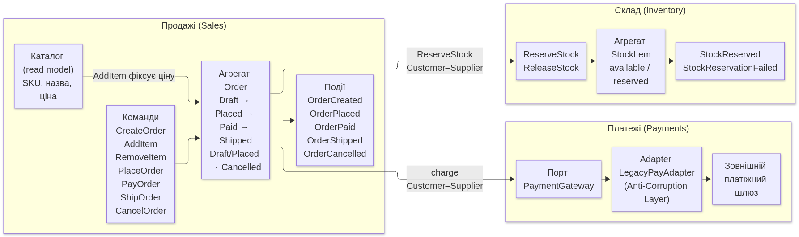

# Ядро домену інтернет-магазину електроніки

**Лабораторна робота № 1.** Архітектурне моделювання та проєктування ядра системи сучасними засобами програмування

**Варіант 2.** Інтернет-магазин із замовленнями

Виконав: студент групи 7.F3.26, Гольда Роман Павлович

Дата: 2026-11-26

> **Використання AI-асистента.** Під час підготовки використано AI-асистента для чернеток коду, тексту й діаграм. Автор перевірив збірку, тести та `mypy --strict` і може пояснити кожне рішення. Оцінки у зважених матрицях — судження автора, а не вимірювання.

## Зміст

1. [Швидкий старт](#1-швидкий-старт)
2. [Крок 1. Вимоги та сценарії якості](#2-крок-1-вимоги-та-сценарії-якості)
3. [Крок 2. Модель домену](#3-крок-2-модель-домену)
4. [Крок 3. Діаграми C4](#4-крок-3-діаграми-c4)
5. [Крок 4. Вибір стеку та стилю](#5-крок-4-вибір-стеку-та-стилю)
6. [Крок 5. Типобезпечна модель домену](#6-крок-5-типобезпечна-модель-домену)
7. [Крок 6. Патерни, DI, порти](#7-крок-6-патерни-di-порти)
8. [Крок 7. Тести та збірка](#8-крок-7-тести-та-збірка)
9. [Артефакти](#9-артефакти)
10. [Обмеження ЛР1](#10-обмеження-лр1)

## 1. Швидкий старт

Потрібен Python 3.12+ (перевірено на 3.13.0). Залежності — лише для розробки: `pytest` і `mypy`.

```bash
py -3 -m pip install -r requirements-dev.txt
py -3 check.py
```

`check.py` — одна команда, яка послідовно запускає `mypy --strict src` і `pytest`. Очікуваний результат:

```text
Success: no issues found in 22 source files
143 passed
УСІ ПЕРЕВІРКИ ПРОЙДЕНІ
```

Демонстраційний сценарій:

```bash
# Windows PowerShell
$env:PYTHONPATH="src"; py -3 -m shop.demo
# Linux/macOS
PYTHONPATH=src python3 -m shop.demo
```

Структура репозиторію:

```text
shop-core/
├── README.md, pyproject.toml, requirements-dev.txt, check.py
├── docs/
│   ├── requirements.md, domain-model.md, decision-matrix.md
│   ├── testing.md, type-safety.md
│   ├── adr/0001-python-modular-monolith.md
│   ├── c4/context.puml, container.puml, *.png, lib/
│   ├── diagrams/domain.mmd, domain.png
│   └── type-safety/*.py
├── src/shop/
│   ├── domain/      # Result, Money, Order, StockItem, події, фабрики, ціни
│   ├── application/ # OrderService, порти
│   ├── infrastructure/ # пам'ять, годинник, адаптер платежів
│   └── demo.py
└── tests/           # 143 тести
```

## 2. Крок 1. Вимоги та сценарії якості

### Користувацькі історії

- **US-1.** Як покупець, я хочу переглядати каталог і шукати товари за назвою або артикулом, щоб обрати потрібну електроніку.
- **US-2.** Як покупець, я хочу додавати й прибирати товари в кошику та бачити суму зі знижкою й ПДВ, щоб знати остаточну ціну до оформлення.
- **US-3.** Як покупець, я хочу оформити замовлення, обравши доставку й оплату, щоб завершити покупку.
- **US-4.** Як покупець, я хочу оплатити замовлення через зовнішній шлюз і отримати підтвердження, щоб замовлення стало оплаченим.
- **US-5.** Як агент підтримки, я хочу бачити стан замовлення й скасовувати неоплачене замовлення до відправлення, щоб допомогти покупцеві.

Детальні критерії приймання — у [`docs/requirements.md`](docs/requirements.md).

### Обмеження та припущення

| Обмеження | Значення | Джерело |
|---|---|---|
| Пікове навантаження | 500 замовлень/хв ≈ 8,3/с; середнє 50/хв | умова варіанта |
| Затримка оформлення | p95 ≤ 800 мс на стороні системи, без шлюзу | умова варіанта |
| Подвійне списання | неприпустиме; операції ідемпотентні | умова варіанта |
| Продаж без залишку | заборонений; резервування під час оформлення | умова варіанта |
| Відмова шлюзу | не зупиняє каталог і кошик | умова варіанта |
| Валюта / ПДВ | UAH; ПДВ 20% у демонстрації, ставка параметризується | припущення ЛР1 |
| Тарифи доставки | кур'єр 99 UAH, самовивіз 0, експрес 199 | припущення ЛР1 |
| Команда | 1 розробник, 12 тижнів | організаційне припущення |

### Сценарії якості

| Сценарій | Джерело | Стимул | Артефакт | Середовище | Реакція | Міра відповіді |
|---|---|---|---|---|---|---|
| **QS-1 Продуктивність** | Покупець | Оформлює замовлення в пік | `OrderService`: кошик, ціни, резерв, збереження | 500 замовлень/хв, 10× середнього | Замовлення в `Placed`, резерв створено | p95 ≤ 800 мс без шлюзу; помилок ≤ 0,1% |
| **QS-2 Доступність та ізоляція** | Платіжний шлюз | Не відповідає 30 с | Оформлення й каталог/кошик | Пікове навантаження | Замовлення лишається `Placed`; каталог і кошик працюють; повтор ідемпотентний | p95 каталогу ≤ 300 мс; 100% невдалих платежів не переходять у `Paid`; 0 подвійних списань на 100 повторів |
| **QS-3 Узгодженість** | 50 покупців | Купують останню одиницю SKU | Склад і замовлення | Пікове навантаження | 1 замовлення резервує одиницю, решта — `InsufficientStock` | 1 успіх із 50; 0 перепродажів; 0 від'ємних залишків; p95 ≤ 800 мс |

Усі три сценарії **архітектурно значущі**: QS-1 і QS-3 вимагають однієї транзакції без мережевих стрибків, QS-2 — порту й адаптера для шлюзу та стабільного idempotency key. Деталі та трасування — у [`docs/requirements.md`](docs/requirements.md).

## 3. Крок 2. Модель домену

Event storming дав 11 подій, 7 команд, 2 повноцінні агрегати й 3 bounded context.

| № | Подія | Команда | Агрегат | Контекст | У коді ЛР1 |
|---|---|---|---|---|---|
| 1 | `OrderCreated` | `CreateOrder` | Order | Продажі | так |
| 2 | `ItemAddedToCart` | `AddItem` | Order | Продажі | команда так, події немає |
| 3 | `ItemRemovedFromCart` | `RemoveItem` | Order | Продажі | команда так, події немає |
| 4 | `OrderPlaced` | `PlaceOrder` | Order | Продажі | так |
| 5 | `OrderPaid` | `PayOrder` | Order (стан `Paid`) | Продажі + Платежі | так |
| 6 | `PaymentFailed` | `PayOrder` | Payment (межа) | Платежі | так, як `PaymentDeclined`/`PaymentUnavailable` |
| 7 | `OrderShipped` | `ShipOrder` | Order | Продажі | так |
| 8 | `OrderCancelled` | `CancelOrder` | Order | Продажі | так |
| 9 | `StockReserved` | `ReserveStock` | StockItem | Склад | так, як успішний `reserve` |
| 10 | `StockReservationFailed` | `ReserveStock` | StockItem | Склад | так, як `InsufficientStock` |
| 11 | `StockReleased` | `ReleaseStock` | StockItem | Склад | так, як `release` |

| Зв'язок контекстів | Тип | Обґрунтування |
|---|---|---|
| Продажі → Склад | Customer–Supplier | Продажі залежать від резервування; Склад визначає контракт `reserve`/`release` |
| Продажі → Платежі | Customer–Supplier | Продажі замовляють списання; Платежі повертають `PaymentReceipt` або `DomainError` |
| Продажі ↔ Склад | Shared Kernel (`Sku`) | Спільний артикул; зміна формату потребує узгодження |
| Платежі → зовнішній шлюз | Anti-Corruption Layer | Адаптер перекладає мінорні одиниці, статуси й винятки SDK |



Код діаграми: [`docs/diagrams/domain.mmd`](docs/diagrams/domain.mmd). Деталі — [`docs/domain-model.md`](docs/domain-model.md).

### Глосарій

| Термін | Значення |
|---|---|
| Товар (Product) | Картка каталогу: артикул, назва, поточна ціна, наявність |
| Замовлення (Order) | Агрегат `Draft → Placed → Paid → Shipped` або `→ Cancelled` |
| Кошик (Draft) | Стан до оформлення; позиції із зафіксованими цінами |
| Позиція (OrderLine) | Артикул, назва, ціна за одиницю, кількість |
| Резервування | Одиниці товару, закріплені за замовленням |
| Залишок (StockItem) | Скільки одиниць доступно й зарезервовано |
| Ідемпотентність | Повторна оплата з тим самим ключем не списує двічі |

## 4. Крок 3. Діаграми C4

Контекстна діаграма (рівень 1): покупець і менеджер працюють із магазином; магазин викликає платіжний шлюз і службу доставки.


Контейнерна діаграма (рівень 2): SPA, модульний моноліт `Shop Application` на Python 3.13 / FastAPI, PostgreSQL 16 і зовнішні сервіси.


Код: [`context.puml`](docs/c4/context.puml), [`container.puml`](docs/c4/container.puml). Кожен елемент підписаний призначенням, контейнери — технологією, кожен зв'язок — способом взаємодії (`HTTPS/JSON`, `HTTPS/REST`, `SQL/TLS`). Рендер і ліцензія C4-PlantUML — у [`docs/c4/README.md`](docs/c4/README.md).

## 5. Крок 4. Вибір стеку та стилю

### Архітектурний стиль

| Критерій | Вага | Модульний моноліт | Мікросервіси |
|---|---:|---|---|
| QS-1 Продуктивність | 5 | 5 · усе в одному процесі, без мережевих стрибків | 3 · виклик «замовлення → склад» у гарячому шляху |
| QS-2 Доступність та ізоляція | 5 | 3 · падіння модуля впливає на весь застосунок | 5 · збій платежів не зупиняє каталог |
| QS-3 Узгодженість | 5 | 5 · одна ACID-транзакція | 2 · saga, компенсації, eventual consistency |
| Змінюваність | 3 | 3 · новий модуль + спільний деплой | 4 · незалежний деплой сервісу |
| Вартість розробки (1 розробник) | 4 | 5 · одна кодова база, один CI | 2 · кілька сервісів і контрактів |
| Експлуатація | 3 | 5 · один застосунок і одна БД | 2 · розподілені трасування, мережі, інциденти |
| **Сума (макс. 125)** | **25** | **109** | **76** |

### Мова й рантайм

| Критерій | Вага | Python 3.13 | Java 21 |
|---|---:|---|---|
| Виразність моделі | 5 | 5 · `frozen dataclass`, `Union`, `match` | 5 · `record`, `sealed`, `switch` |
| Гарантії компілятора | 4 | 4 · `mypy --strict` + `assert_never` | 5 · `javac` перевіряє вичерпність |
| Продуктивність на 8,3/с | 2 | 3 · GIL не критичний для I/O | 5 · JVM і віртуальні потоки |
| Екосистема | 3 | 5 · багато бібліотек, швидкий старт | 4 · зрілі корпоративні бібліотеки |
| Досвід розробника | 5 | 5 · основна мова, середовище готове | 3 · JDK 21 треба встановлювати |
| Простота збірки | 4 | 5 · `pip`, `pytest`, `mypy` | 3 · Gradle, JDK 21 |
| Пам'ять | 1 | 2 · більший відбиток | 4 · JVM ефективніша |
| **Сума (макс. 120)** | **24** | **109** | **98** |

**Висновок:** модульний моноліт на Python 3.13. Вирішальні фактори — одна транзакція «замовлення + резерв» (QS-3), низьке навантаження, команда з одного розробника й готовий Python. Java має сильніші компіляторні гарантії, але програє за вартістю налаштування; мікросервіси виграють лише за ваг доступності й змінюваності (54 : 50). Повні матриці та перевірка стійкості — у [`docs/decision-matrix.md`](docs/decision-matrix.md), рішення — в [`ADR-001`](docs/adr/0001-python-modular-monolith.md).

## 6. Крок 5. Типобезпечна модель домену

| Вимога | Реалізація | Що гарантує |
|---|---|---|
| Незмінні Value Object-и | `Money`, `Sku`, `OrderId`, `OrderLine`, `Address`, `TrackingNumber` | Поля не змінюються; інваріанти в `__post_init__` |
| Sealed-ієрархії | `Command`, `OrderEvent`, `DomainError`, `Order`, `DeliveryMethod`, `PaymentMethod` | Закрита множина варіантів |
| Стани агрегату | `Draft`, `Placed`, `Paid`, `Shipped`, `Cancelled` | Метод є лише в дозволеному стані |
| Result/Either | `Ok[T]`, `Err[E]`, `map_result`, `flat_map` | Очікувані помилки — значення |
| Pattern matching | `state_name`, `describe_error`, `handle`, `delivery_label` | `assert_never` вимагає вичерпності |
| Generics | `Result[T, E]`, `Transition[S, E]`, `Repository[A, Id]` | Повторне використання без втрати типів |

```python
@dataclass(frozen=True, slots=True)
class Money:
    amount: Decimal
    currency: Currency

    def __post_init__(self) -> None:
        if not self.amount.is_finite():
            raise ValueError("amount має бути скінченним")
        if self.amount < 0:
            raise ValueError("amount не може бути від'ємним")
        object.__setattr__(self, "amount", self.amount.quantize(Decimal("0.01")))

@dataclass(frozen=True, slots=True)
class Placed:
    ...
    def pay(self, receipt: PaymentReceipt, at: datetime) -> Result[Transition[Paid, OrderPaid], DomainError]:
        if receipt.amount != self.total:
            return Err(TotalMismatch(self.total, receipt.amount))
        ...

@dataclass(frozen=True, slots=True)
class Paid:
    ...
    def ship(self, tracking: TrackingNumber, at: datetime) -> Result[Transition[Shipped, OrderShipped], DomainError]:
        ...
```

`Draft` не має `pay`, `Placed` не має `ship`, `Paid` не має `cancel`: недопустимий перехід не компілюється. `mypy --strict` на навмисно неправильних файлах дає:

```text
docs/type-safety/invalid_transition.py:13: error: "Draft" has no attribute "ship"
docs/type-safety/incomplete_match.py:17: error: Argument 1 to "assert_never" has incompatible type "Placed | Paid | Shipped | Cancelled"; expected "Never"
docs/type-safety/wrong_currency.py:11: error: Argument 2 to "Money" has incompatible type "str"; expected "Currency"
```

Ці файли не входять у `src/` і не запускаються. Деталі — у [`docs/type-safety.md`](docs/type-safety.md).

## 7. Крок 6. Патерни, DI, порти

| Патерн | Група | Де | Яку проблему розв'язує | Ціна |
|---|---|---|---|---|
| **Factory Method** | Породжувальний | `domain/factories.py` | Коди доставки/оплати з зовнішнього API не повинні розкидати `if/elif` і конструктори по сервісу; новий спосіб — нова фабрика | Зайві класи й реєстр; для двох способів простіша функція була б коротшою |
| **Decorator** | Структурний | `domain/pricing.py` | Знижки й ПДВ комбінуються незалежно; агрегат не повинен знати ланцюжок | Порядок обгортання неявний; глибокий ланцюг важче налагоджувати; можна випадково застосувати двічі |
| **Adapter** | Структурний | `infrastructure/payment_adapter.py` | Сторонній SDK говорить мінорними одиницями, рядками й винятками; домен не повинен це бачити | Код перетворення й втрата специфічних можливостей провайдера; кожен новий метод шлюзу треба мапити |

Мінімум дві групи виконано: породжувальний + структурні.

```python
service = OrderService(
    orders=InMemoryOrderRepository(),
    inventory=InMemoryInventory({Sku("PHN-0001"): 3}),
    payments=LegacyPayAdapter(SandboxLegacyPayClient(), clock),
    pricing=Vat(PercentageDiscount(BasePrice(Currency.UAH), Decimal("10")), Decimal("0.20")),
    clock=clock,
)
```

| Порт | Призначення | Реалізації |
|---|---|---|
| `OrderRepository` | Збереження агрегату `Order` | `InMemoryOrderRepository`; у ЛР2 — PostgreSQL |
| `InventoryPort` | `reserve`/`release` залишків | `InMemoryInventory`; у ЛР2 — БД |
| `PaymentGateway` | Списання коштів | `LegacyPayAdapter` + `SandboxLegacyPayClient` |
| `Clock` | Поточний час | `SystemClock`; у тестах — `FixedClock` |

| Пакет | Залежить від | Роль |
|---|---|---|
| `domain` | лише стандартна бібліотека | Типи, інваріанти, ціни, фабрики, події |
| `application` | `domain` | `OrderService` і порти |
| `infrastructure` | `application`, `domain` | Адаптери: пам'ять, годинник, шлюз |
| `demo` | усі | Корінь композиції |

Циклів немає; це перевіряють `tests/test_architecture.py`. Деталі патернів — у коді та [`docs/decision-matrix.md`](docs/decision-matrix.md).

## 8. Крок 7. Тести та збірка

```bash
py -3 check.py
```

| Файл | Що перевіряє | Тестів |
|---|---|---:|
| `test_money.py` | Суми, NaN, округлення, валюти, `parse` | 21 |
| `test_ids.py` | Артикули, UUID, адреси, трекінг | 22 |
| `test_pricing.py` | Знижки, ПДВ, порядок декораторів | 18 |
| `test_factories.py` | Коди доставки й оплати | 12 |
| `test_adapter.py` | Успіх, відмова, виняток, idempotency key | 8 |
| `test_inventory.py` | Резерв, звільнення, all-or-nothing | 11 |
| `test_order.py` | Переходи станів і часові інваріанти | 21 |
| `test_order_service.py` | Наскрізні сценарії та повторна оплата | 22 |
| `test_result.py` | `map`, `flat_map`, `unwrap_or` | 6 |
| `test_architecture.py` | Напрямок залежностей | 2 |
| **Разом** | | **143** |

```text
$ py -3 -m mypy --strict src
Success: no issues found in 22 source files

$ py -3 -m pytest -q
143 passed
```

Демонстраційний запуск показує повний цикл `Draft → Placed → Paid → Shipped`, відмову платежу з поверненням у `Placed` і звільнення резерву під час скасування. Повний вивід і пояснення — у [`docs/testing.md`](docs/testing.md).

## 9. Артефакти

| Артефакт | Посилання |
|---|---|
| Вимоги, 5 історій, 3 сценарії якості | [`docs/requirements.md`](docs/requirements.md) |
| Event storming, контексти, глосарій | [`docs/domain-model.md`](docs/domain-model.md) |
| Діаграма домену (Mermaid + PNG) | [`docs/diagrams/domain.mmd`](docs/diagrams/domain.mmd) |
| C4 Context і Container (код + PNG) | [`docs/c4/`](docs/c4/) |
| Зважені матриці та стійкість | [`docs/decision-matrix.md`](docs/decision-matrix.md) |
| ADR-001 | [`docs/adr/0001-python-modular-monolith.md`](docs/adr/0001-python-modular-monolith.md) |
| Докази типобезпеки | [`docs/type-safety.md`](docs/type-safety.md) |
| Тести та збірка | [`docs/testing.md`](docs/testing.md) |
| Код домену | [`src/shop/domain/`](src/shop/domain/) |
| Сервіс і порти | [`src/shop/application/`](src/shop/application/) |
| Адаптери | [`src/shop/infrastructure/`](src/shop/infrastructure/) |
| Тести | [`tests/`](tests/) |

## 10. Обмеження ЛР1

- Каталог у ЛР1 — read model і фіксація ціни в позиції; окремого сервісу пошуку немає.
- Повернення після відправлення й refund не моделюються: `Paid` не можна скасувати.
- Реальних PostgreSQL, HTTP і черг немає: адаптери в пам'яті; це межа ЛР1 і матеріал ЛР2–ЛР5.
- Конкурентний перепродаж перевіряється на рівні агрегата й сервісу, а не реальними транзакціями БД.
- p95 не вимірюється: сценарій QS-1 визначає архітектуру, вимірювання — у наступних роботах.
- Оцінки в матрицях — судження автора; на захисті кожна пояснюється.
