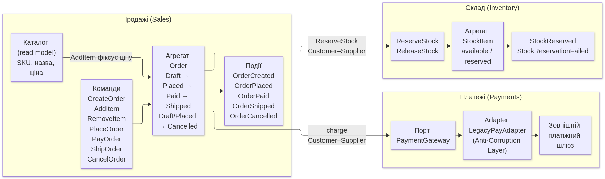

# Модель домену: event storming, контексти, глосарій

## 1. Спрощений event storming

Семінар проведено в шість кроків:

1. Виписали доменні події в минулому часі: `OrderCreated`, `OrderPlaced`, `OrderPaid`, `OrderShipped`, `OrderCancelled`, `StockReserved`, `StockReservationFailed`, `StockReleased`, `PaymentFailed` та інші.
2. До кожної події додали команду, що її спричиняє: `CreateOrder`, `AddItem`, `PlaceOrder`, `PayOrder`, `ShipOrder`, `CancelOrder`, `ReserveStock`, `ReleaseStock`.
3. Згрупували команди й події навколо агрегатів, які перевіряють інваріанти: `Order` і `StockItem`.
4. Позначили політики: після `OrderPlaced` виконується `ReserveStock`; під час `CancelOrder` для стану `Placed` виконується `ReleaseStock`.
5. Згрупували поняття у три bounded context: «Продажі», «Склад», «Платежі».
6. Побудували context map і перевірили, що кожна межа має власну модель і власні правила.

## 2. Події, команди й агрегати

| № | Подія (минулий час) | Команда | Агрегат | Контекст | У коді ЛР1 |
|---|---|---|---|---|---|
| 1 | `OrderCreated` | `CreateOrder` | Order | Продажі | так, тип `OrderCreated` |
| 2 | `ItemAddedToCart` | `AddItem` | Order | Продажі | команда так; окремої події немає |
| 3 | `ItemRemovedFromCart` | `RemoveItem` | Order | Продажі | команда так; окремої події немає |
| 4 | `OrderPlaced` | `PlaceOrder` | Order | Продажі | так, тип `OrderPlaced` |
| 5 | `OrderPaid` | `PayOrder` | Order (стан `Paid`) | Продажі + Платежі | так, тип `OrderPaid` |
| 6 | `PaymentFailed` | `PayOrder` | Payment (межа контексту) | Платежі | так, як `PaymentDeclined` / `PaymentUnavailable` |
| 7 | `OrderShipped` | `ShipOrder` | Order | Продажі | так, тип `OrderShipped` |
| 8 | `OrderCancelled` | `CancelOrder` | Order | Продажі | так, тип `OrderCancelled` |
| 9 | `StockReserved` | `ReserveStock` (політика після `OrderPlaced`) | StockItem | Склад | так, як успішний `InventoryPort.reserve` |
| 10 | `StockReservationFailed` | `ReserveStock` | StockItem | Склад | так, як `InsufficientStock` |
| 11 | `StockReleased` | `ReleaseStock` (компенсація під час скасування) | StockItem | Склад | так, як `InventoryPort.release` |

Разом: 11 доменних подій, 7 команд, 2 повноцінні агрегати (`Order`, `StockItem`) і 3 bounded context. Контекст «Платежі» в ЛР1 представлений портом `PaymentGateway` і адаптером; повний агрегат `Payment` з журналом спроб — матеріал ЛР2+.

### Агрегат Order

Відповідає за життєвий цикл замовлення й незмінність позицій:

- `Draft` — кошик; можна додавати й прибирати позиції, оформити або скасувати;
- `Placed` — замовлення оформлене, товар зарезервовано; можна оплатити або скасувати;
- `Paid` — оплата підтверджена; можна відправити;
- `Shipped` — кінцевий стан; зберігається трекінг;
- `Cancelled` — кінцевий стан; зберігається причина.

Кожен стан — окремий тип. Метод `pay` існує лише в `Placed`, метод `ship` — лише в `Paid`, тому недопустимий перехід не компілюється (див. `docs/type-safety.md`).

### Агрегат StockItem

Відповідає за залишок одного артикулу:

- `available` — доступно до продажу;
- `reserved` — зарезервовано під замовлення;
- `reserve(quantity)` зменшує `available` і збільшує `reserved`, але не допускає від'ємного залишку;
- `release(quantity)` повертає одиниці з `reserved` у `available`.

## 3. Bounded context і context map

| Контекст | Що всередині | Ключовий агрегат |
|---|---|---|
| Продажі (Sales) | Каталог як read model, кошик, оформлення, ціноутворення, життєвий цикл замовлення | Order |
| Склад (Inventory) | Залишки, резервування та звільнення | StockItem |
| Платежі (Payments) | Порт платіжного шлюзу, адаптер, обробка відмов | Payment на межі контексту |

| Зв'язок | Тип | Обґрунтування |
|---|---|---|
| Продажі → Склад | Customer–Supplier | Продажі залежать від резервування; Склад визначає контракт `reserve`/`release` і може відхилити запит через `InsufficientStock` |
| Продажі → Платежі | Customer–Supplier | Продажі замовляють списання; Платежі повертають `PaymentReceipt` або `DomainError`, не розкриваючи деталей шлюзу |
| Продажі ↔ Склад | Shared Kernel (`Sku`) | Обидва контексти використовують спільний артикул; зміна формату `Sku` потребує узгодження |
| Платежі → зовнішній шлюз | Anti-Corruption Layer | `LegacyPayAdapter` перекладає мінорні одиниці, рядкові статуси й винятки SDK у типи домену |

Межа «Продажі — Склад» проходить між `OrderLine` (ціна й кількість у замовленні) і `StockItem` (лише артикул і кількість). Товар у каталозі має поточну ціну, а в замовленні фіксується ціна на момент додавання — це різні моделі одного поняття.

## 4. Діаграма домену

Код діаграми: [`docs/diagrams/domain.mmd`](diagrams/domain.mmd).

## 5. Глосарій

| Термін | Значення |
|---|---|
| Товар (Product) | Картка каталогу: артикул, назва, поточна ціна, ознака наявності |
| Замовлення (Order) | Агрегат із життєвим циклом `Draft → Placed → Paid → Shipped` або `→ Cancelled` |
| Кошик (Draft) | Стан замовлення до оформлення; містить позиції з зафіксованими цінами |
| Позиція замовлення (OrderLine) | Артикул, назва, ціна за одиницю й кількість; має власну суму |
| Резервування (Reservation) | Одиниці товару, закріплені за замовленням на складі |
| Залишок (StockItem) | Агрегат складу: скільки одиниць доступно й скільки зарезервовано |
| Ідемпотентність (Idempotency) | Повторна оплата з тим самим ключем не створює друге списання |

## 6. Що реалізовано в ЛР1

- Повністю: агрегати `Order` і `StockItem`, команди, події замовлення, `Result`, стани, ціноутворення, фабрики, адаптер платежів.
- Частково: контекст «Платежі» — через порт і адаптер, без окремого агрегата `Payment`.
- Поза межами ЛР1: каталог як окремий сервіс пошуку, повернення після відправлення, реальна база даних і HTTP-API. Це розвивається в ЛР2–ЛР5.
